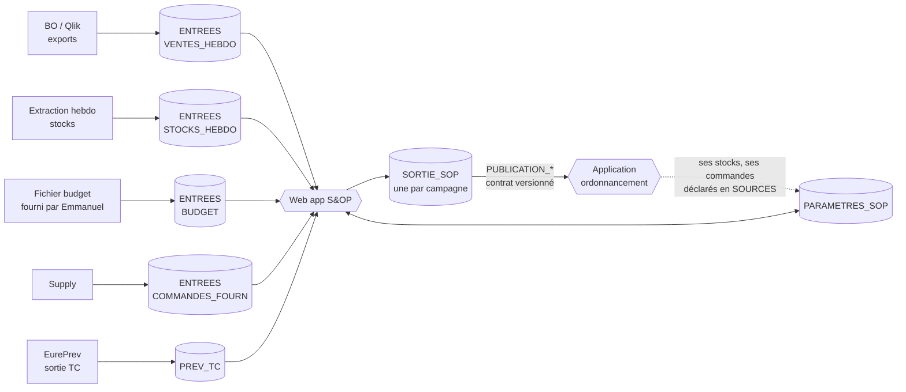

# Structure des feuilles Google Sheets – S&OP

Ce document décrit les classeurs de l'application S&OP (web app Apps Script). Il suit le modèle d'EurePrev : **un fichier de paramètres**, **un fichier de sortie**, et des fichiers d'entrée déclarés dans les paramètres. Les tableaux détaillés à la fin sont générés par `outils/structure.py`, qui produit aussi les en-têtes prêts à importer dans `modeles/`.

## 1. Vue d'ensemble

| Rôle | Fichier | Qui écrit | Durée de vie |
|---|---|---|---|
| Référentiels et réglages | **PARAMETRES_SOP** | Administrateur, responsables de marché, supply | Permanent |
| Données brutes | **ENTREES** (un fichier par flux) | Personnes ou exports automatiques, jamais l'application | Rafraîchi |
| Résultats et traces | **SORTIE_SOP** | L'application uniquement | Une par campagne, archivée ensuite |

Les autres applications (ordonnancement des commandes, EurePrev) ne lisent que les onglets `PUBLICATION_*` de la sortie et le fichier de paramètres. Elles ne touchent jamais à `PREVISION`.

## 2. Ce qui est repris d'EurePrev

| EurePrev | S&OP | Changement |
|---|---|---|
| CAMPAGNES | CAMPAGNES | Ajout du type (PAC1 à PAC4, MORTE_SAISON), de l'horizon |
| REGLAGES, PROFILS | REGLAGES, PROFILS | Nouveaux rôles (PREV, AM) et droits (arbitrage, validation, voir budget) |
| TC | TC | Identique : même codes, même e-mails |
| ACCES_PAC | ACCES | Ajout de Marche, Plateforme |
| PRODUITS_PAC (par campagne) | PRODUITS (permanent) + GAMME (par campagne) | Poids article et densité pour passer en tonnes |
| PLATEFORMES | AFFECTATION_PLATEFORME + PLATEFORMES | La liste des lieux de stockage devient un onglet à part |
| MENSUALISATION | COEFFICIENTS | Niveaux marché, famille, article, plateforme ; mois puis semaine du mois |
| SOURCES, ARBITRAGES | SOURCES, ARBITRAGES | SOURCES décrit aussi la nature du flux et son responsable |
| DONNEES, JOURNAL, OPERATIONS | PREVISION, JOURNAL, OPERATIONS | Même logique : verrou, reçus, auteur réel |

Le classeur EurePrev reste la source des prévisions des TC : la nature `PREV_TC` de l'onglet SOURCES pointe vers sa sortie.

## 3. Règles communes

- Codes produit, codes TC, identifiants : **texte**. Zéros initiaux conservés.
- Mois `AAAA-MM`. Semaine `AAAA-Sss` (ISO, lundi). Dates `AAAA-MM-JJ`.
- OUI / NON en majuscules. **Une cellule vide n'est pas zéro.**
- Unité de stock partout dans les données ; les **tonnes** sont calculées : quantité × poids article. Affichage `# ##0" T"` à l'article, `# ##0"T"` aux grosses mailles, comme demandé.
- Les libellés de données doivent écrire « Eureden » (charte). Les valeurs servant de clés (par exemple `Coop EUREDEN` dans `_Canal de distribution`) restent **identiques à la source** : c'est l'écran qui les affiche en « Eureden ».
- Aucune ligne de PREVISION, JOURNAL ou OPERATIONS n'est triée, insérée ou supprimée à la main.

## 4. Versions et reprévisions

Le besoin « garder la trace de chaque reprévision » est couvert à trois niveaux :

1. **PREVISION** contient uniquement la version courante, avec les colonnes par source côte à côte : historique corrigé, statistique, TC, événements, correction, arbitrée, validée.
2. **INSTANTANES** garde une photo de la quantité retenue à chaque figement de version. Cela permet de comparer v1, v2, v3.
3. **JOURNAL** garde chaque modification : ancienne valeur, nouvelle valeur, auteur, motif.

Une version validée est verrouillée. Le fichier `BUDGET` étant sensible, l'application masque ses colonnes aux rôles qui n'ont pas `Voir budget`.

## 5. Le contrat de publication

Les onglets `PUBLICATION_MENSUELLE` et `PUBLICATION_HEBDO` sont les seuls que les autres applications ont le droit de lire. Ils sont réécrits entièrement à chaque validation de version. `CONTRAT` décrit chaque colonne et porte un numéro de version. Une évolution du schéma incrémente ce numéro, ce qui évite de casser l'ordonnancement sans le prévenir.

- **Mensuel :** article × entité × plateforme × mois, sur l'horizon de la campagne.
- **Hebdomadaire :** même grain, sur l'horizon du suivi de stock actuel (78 semaines par défaut, réglable). Il ne porte que sur les articles suivis en stock, quelques dizaines par plateforme.

## 6. Le suivi de stock (modèle observé dans vos fichiers)

Votre suivi actuel (onglet GLOMEL v3) projette, pour chaque article et chaque semaine, ces mouvements. Environ 40 articles sur Glomel, de la semaine 32 de 2025 à la semaine 26 de 2027.

| Mouvement | Nature | D'où vient la donnée |
|---|---|---|
| STOCK_DEBUT | Calculé | Stock de fin de la semaine précédente. Première semaine : STOCKS_HEBDO |
| ACHATS | Entrée | COMMANDES_FOURN, reste à livrer, à la date limite de livraison |
| BESOIN_REAPPRO | **Sortie du calcul** | Quantité à commander pour tenir le stock mini (PARAMETRES_STOCK) |
| RETOURS_MAGASINS | Entrée | Estimé (à préciser) |
| TRANSFERT_ENTRANT | Entrée | Autre plateforme, via ROUTES_APPRO (ex. transfert de Gruel Fayer) |
| VENTES_PREV | Sortie | Prévision arbitrée de la semaine, une ligne par entité (Coop, ONA) |
| REPORT_VENTES | Entrée ou sortie | SUBSTITUTIONS : flufénacet, arrêt Minarix |
| STOCK_FIN | Calculé | Début + entrées − sorties |

### Ruptures : lire la demande et le réel en parallèle

Une rupture ne supprime pas la demande. L'application garde donc deux lectures de la même prévision :

| | Vue DEMANDE | Vue REEL |
|---|---|---|
| Question | Que se passerait-il si l'article était disponible ? | Que va-t-il vraiment se passer ? |
| Ventes | La prévision arbitrée, sans contrainte | Plafonnées par le stock disponible pendant la rupture |
| Stock | Peut devenir négatif : le négatif est le manque à combler | Plancher à zéro |
| Ventes non réalisées | Aucune | Affichées en VENTES_PERDUES, ou reportées plus tard, ou transférées à un substitut |

Chaque rupture est déclarée dans l'onglet `RUPTURES` : article, plateforme, semaines de début et de fin, cause, et **traitement des ventes** :

- **PERDUES** : elles disparaissent du réel et restent visibles comme ventes perdues.
- **REPORTEES** : un taux de ventes revient à une semaine de retour fixée. Le report apparaît en REPORT_VENTES.
- **SUBSTITUEES** : un taux passe sur un autre article, par le même mécanisme que SUBSTITUTIONS.

Dans le passé, c'est CORRECTIONS_HISTO (type RUPTURE) : la quantité brute est ce qui a été vendu, la quantité corrigée est la demande estimée. Le brut n'est jamais écrasé. Les prévisions statistiques se calculent sur l'historique corrigé.

Une rupture prévue est proposée automatiquement par l'application dès que le stock projeté passe sous zéro (alerte RUPTURE_PREVUE). Le prévisionniste confirme, choisit le traitement, ou rejette. Les deux quantités sont publiées aux autres applications (`Quantite demande`, `Quantite reelle`). La vue DEMANDE du stock n'est stockée que pour les articles qui ont une rupture.

Les lignes « Ventes prévisionnelles ONA » du suivi deviennent une ligne VENTES_PREV avec `Entite = ONA`, pas un mouvement à part.

## 7. Volumes à surveiller

Un classeur Google Sheets est limité à 10 millions de cellules. EurePrev en utilise déjà environ 6,9 millions pour 175 745 lignes.

Estimation à confirmer avec les vraies données. Hypothèses : 1 500 articles actifs avec 3 plateformes en moyenne pour la prévision mensuelle ; 80 articles suivis en stock sur 3 plateformes pour le suivi hebdomadaire, sur 78 semaines et 8 mouvements.

| Onglet | Lignes | Colonnes | Cellules |
|---|---|---|---|
| PREVISION | 54 000 | 19 | ≈ 1,0 M |
| INSTANTANES (8 versions) | 432 000 | 3 | ≈ 1,3 M |
| PUBLICATION_MENSUELLE | 54 000 | 11 | ≈ 0,6 M |
| PUBLICATION_HEBDO | 18 700 | 11 | ≈ 0,2 M |
| STOCKS_PROJETES (version courante) | 150 000 | 9 | ≈ 1,4 M |
| **Total SORTIE_SOP** | | | **≈ 4,5 M** |

C'est confortable. Le point sensible est `VENTES_HEBDO` : l'export actuel est à la ligne facturée, il doit être agrégé par semaine, article et point avant dépôt. Les ventes restent en **un fichier par année civile**.

## 8. Points à valider avant de créer les fichiers

1. **Poids article :** disponible dans un Google Sheet (réponse reçue). Il est déclaré dans SOURCES avec la nature `POIDS_ARTICLE` et copié dans PRODUITS. Reste à fournir le lien et ses colonnes.
2. **Rattachement semaine → mois :** mois du jeudi de la semaine (validé).
3. **Grain de la prévision :** article × plateforme × mois (validé) pour le comité. Vos fichiers sont hebdomadaires : le stockage et la publication à la semaine sont proposés et restent à valider. La prévision des TC est annuelle par TC et article ; le passage au mois et à la plateforme se fait via AFFECTATION_PLATEFORME et COEFFICIENTS.
4. **Qui définit les coefficients :** à décider (réponse reportée). L'onglet prévoit `Valide par` et un numéro de version.
5. **Rôles (validés) :** ADMIN, PREV, RM, AM, RT, CD, RBP, TC, SUPPLY. Le contrôle de gestion et la direction n'ont pas de rôle : ils reçoivent les exports du comité. Reste à confirmer ce que peut corriger chaque rôle.
6. **Fichier d'ordonnancement :** quand l'application d'ordonnancement existera, ses colonnes de lecture sont à ajouter à `CONTRAT`.
7. **Droits budget :** par défaut seuls ADMIN et PREV ont `Voir budget` (PROFILS). Accord d'Emmanuel à obtenir pour élargir.
8. **À clarifier :** date de référence des ventes (commande ou livraison), sens de « PAC/PAL », sens de « HS GLOMEL », unité des quantités du suivi de stock, doublon « Besoin de Réappro » sur COLZOR TRIO 20 L.
