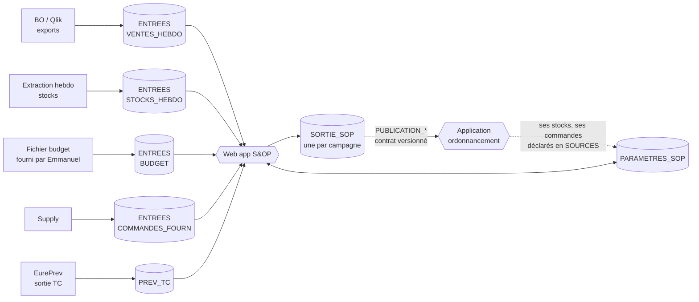

# Structure des feuilles Google Sheets – S&OP

Ce document décrit les classeurs de l'application S&OP (web app Apps Script). Il suit le modèle d'EurePrev : **un fichier de paramètres**, **un fichier de sortie**, et des fichiers d'entrée déclarés dans les paramètres. Les tableaux détaillés à la fin sont générés par `outils/structure.py`, qui produit aussi les en-têtes prêts à importer dans `modeles/`.

## 1. Vue d'ensemble

| Rôle | Fichier | Qui écrit | Durée de vie |
|---|---|---|---|
| Référentiels et réglages | **PARAMETRES_SOP** | Administrateur, responsables de marché, supply | Permanent |
| Données brutes | **ENTREES** (un fichier par flux) | Personnes ou exports automatiques, jamais l'application | Rafraîchi |
| Résultats et traces | **SORTIE_SOP** | L'application uniquement | Une par campagne, archivée ensuite |

Les autres applications (ordonnancement des commandes, EurePrev) ne lisent que les onglets `PUBLICATION_*` de la sortie et le fichier de paramètres. Elles ne touchent jamais à `PREVISION`.

## 2. Ce qui est repris d'EurePrev

| EurePrev | S&OP | Changement |
|---|---|---|
| CAMPAGNES | CAMPAGNES | Ajout du type (PAC1 à PAC4, MORTE_SAISON), de l'horizon |
| REGLAGES, PROFILS | REGLAGES, PROFILS | Nouveaux rôles (PREV, AM) et droits (arbitrage, validation, voir budget) |
| TC | TC | Identique : même codes, même e-mails |
| ACCES_PAC | ACCES | Ajout de Marche, Plateforme |
| PRODUITS_PAC (par campagne) | PRODUITS (permanent) + GAMME (par campagne) | Poids article et densité pour passer en tonnes |
| PLATEFORMES | AFFECTATION_PLATEFORME + PLATEFORMES | La liste des lieux de stockage devient un onglet à part |
| MENSUALISATION | COEFFICIENTS | Cadençage **à la semaine** (semaine ISO) ; niveaux marché, famille, article, plateforme |
| SOURCES, ARBITRAGES | SOURCES, ARBITRAGES | SOURCES décrit aussi la nature du flux et son responsable |
| DONNEES, JOURNAL, OPERATIONS | PREVISION, JOURNAL, OPERATIONS | Même logique : verrou, reçus, auteur réel |

Le classeur EurePrev reste la source des prévisions des TC : la nature `PREV_TC` de l'onglet SOURCES pointe vers sa sortie.

## 3. Règles communes

- Codes produit, codes TC, identifiants : **texte**. Zéros initiaux conservés.
- Mois `AAAA-MM`. Semaine `AAAA-Sss` (ISO, lundi). Dates `AAAA-MM-JJ`.
- OUI / NON en majuscules. **Une cellule vide n'est pas zéro.**
- Unité de stock partout dans les données ; les **tonnes** sont calculées : quantité × poids article. Affichage `# ##0" T"` à l'article, `# ##0"T"` aux grosses mailles, comme demandé.
- Les libellés de données doivent écrire « Eureden » (charte). Les valeurs servant de clés (par exemple `Coop EUREDEN` dans `_Canal de distribution`) restent **identiques à la source** : c'est l'écran qui les affiche en « Eureden ».
- Aucune ligne de PREVISION, JOURNAL ou OPERATIONS n'est triée, insérée ou supprimée à la main.

## 4. Versions et reprévisions

Le besoin « garder la trace de chaque reprévision » est couvert à trois niveaux :

1. **PREVISION** contient uniquement la version courante, avec les colonnes par source côte à côte : historique corrigé, statistique, TC, événements, correction, arbitrée, validée.
2. **INSTANTANES** garde une photo de la quantité retenue à chaque figement de version. Cela permet de comparer v1, v2, v3.
3. **JOURNAL** garde chaque modification : ancienne valeur, nouvelle valeur, auteur, motif.

Une version validée est verrouillée. Le fichier `BUDGET` étant sensible, l'application masque ses colonnes aux rôles qui n'ont pas `Voir budget`.

## 5. Le contrat de publication

Les onglets `PUBLICATION_MENSUELLE` et `PUBLICATION_HEBDO` sont les seuls que les autres applications ont le droit de lire. Ils sont réécrits entièrement à chaque validation de version. `CONTRAT` décrit chaque colonne et porte un numéro de version. Une évolution du schéma incrémente ce numéro, ce qui évite de casser l'ordonnancement sans le prévenir.

- **Mensuel :** article × entité × plateforme × mois, sur l'horizon de la campagne (somme des semaines).
- **Hebdomadaire :** même grain, sur l'horizon du suivi de stock actuel (78 semaines par défaut, réglable). Il ne porte que sur les articles suivis en stock, quelques dizaines par plateforme.

## 6. Le suivi de stock (modèle observé dans vos fichiers)

Votre suivi actuel (onglet GLOMEL v3) projette, pour chaque article et chaque semaine, ces mouvements. Environ 40 articles sur Glomel, de la semaine 32 de 2025 à la semaine 26 de 2027.

| Mouvement | Nature | D'où vient la donnée |
|---|---|---|
| STOCK_DEBUT | Calculé | Stock de fin de la semaine précédente. Première semaine : STOCKS_HEBDO |
| ACHATS | Entrée | COMMANDES_FOURN, reste à livrer, à la date limite de livraison |
| BESOIN_REAPPRO | **Sortie du calcul** | Quantité à commander pour tenir le stock mini (PARAMETRES_STOCK) |
| RETOURS_MAGASINS | Entrée | Estimé (à préciser) |
| TRANSFERT_ENTRANT | Entrée | Autre plateforme, via ROUTES_APPRO (ex. transfert de Gruel Fayer) |
| VENTES_PREV | Sortie | Prévision arbitrée de la semaine, une ligne par entité (Coop, ONA) |
| REPORT_VENTES | Entrée ou sortie | SUBSTITUTIONS : flufénacet, arrêt Minarix |
| STOCK_FIN | Calculé | Début + entrées − sorties |

### Capacités et approvisionnement cadencé

Les capacités sont décrites dans `CAPACITES` : par plateforme, et si besoin par famille, groupe ou marché (stockage séparé des produits dangereux, par exemple). Trois types de capacité :

| Type | Ce qu'il limite |
|---|---|
| STOCKAGE | Le stock présent en même temps sur la plateforme (ou la famille) |
| RECEPTION_HEBDO | Ce qui peut être reçu en une semaine |
| EXPEDITION_HEBDO | Ce qui peut être sorti en une semaine |

L'unité est la **tonne, le kg, le litre ou l'unité**, au choix pour chaque ligne. L'application convertit chaque article avec son poids ou son volume (`PRODUITS` : poids article, unité du poids, densité). Un article qu'on ne peut pas convertir dans l'unité de la capacité est signalé en contrôle.

**Zones et articles dangereux.** Une zone est une partie d'une plateforme, par exemple Cevezo 2 à Glomel (`PLATEFORMES`, type ZONE, plateforme parente GLOMEL). `PRODUITS` indique si un article est dangereux, et `REGLES_STOCKAGE` l'oriente vers la bonne zone : les articles dangereux vont en Cevezo 2, obligatoirement ou de préférence. La zone a sa propre capacité dans `CAPACITES`, en plus de celle de la plateforme. Une capacité peut changer selon la saison (début et fin de validité). Les limites s'additionnent : la plateforme, ses zones, ses familles et ses articles dangereux doivent toutes être respectées.

L'application calcule les commandes en plusieurs passes, article par article puis plateforme par plateforme :

1. **Besoin brut** : la semaine où le stock projeté passerait sous le mini (`PARAMETRES_STOCK`), dans la vue réel.
2. **Contraintes d'achat** : minimum de commande, multiple (camion complet), palier de remise, délai du fournisseur (`CONTRAINTES_APPRO`). Cela donne la semaine de commande.
3. **Contrôle des capacités** : charge projetée par semaine, plateforme et famille (`OCCUPATION_PROJETEE`).
4. **Cadençage** : si une semaine dépasse la capacité de réception ou de stockage, l'application fractionne la livraison, l'avance ou la retarde dans les limites autorisées (« Avance max » et « Retard max » par fournisseur et article). Le stock débord des dépôts compte comme capacité supplémentaire.
5. **Demandes de décalage** : une commande peut être décalée à la demande du **client** ou de la **logistique**. Les personnes autorisées dépendent de la période de campagne (PAC 1 à PAC 4, morte saison) : elles sont listées dans `DECIDEURS_APPRO`, avec leur pouvoir (demander ou accepter). Chaque demande et sa décision sont gardées dans `DEMANDES_DECALAGE`. Une date imposée (verrouillée) n'est plus déplacée par le calcul.
6. **Résultat** : `PLAN_APPRO` garde pour chaque commande la quantité brute, la quantité proposée, le décalage et les contraintes qui ont joué. Les commandes validées sont publiées aux achats et à l'ordonnancement (`PUBLICATION_APPRO`).

Une saturation prévue qu'aucun décalage autorisé ne résout est signalée par l'alerte SATURATION_PREVUE : c'est une décision à prendre en comité (augmenter la capacité, utiliser un dépôt de débord, décaler une campagne).

### Ruptures : lire la demande et le réel en parallèle

Une rupture ne supprime pas la demande. L'application garde donc deux lectures de la même prévision :

| | Vue DEMANDE | Vue REEL |
|---|---|---|
| Question | Que se passerait-il si l'article était disponible ? | Que va-t-il vraiment se passer ? |
| Ventes | La prévision arbitrée, sans contrainte | Plafonnées par le stock disponible pendant la rupture |
| Stock | Peut devenir négatif : le négatif est le manque à combler | Plancher à zéro |
| Ventes non réalisées | Aucune | Affichées en VENTES_PERDUES, ou reportées plus tard, ou transférées à un substitut |

Chaque rupture est déclarée dans l'onglet `RUPTURES` : article, plateforme, semaines de début et de fin, cause, et **traitement des ventes** :

- **PERDUES** : elles disparaissent du réel et restent visibles comme ventes perdues.
- **REPORTEES** : un taux de ventes revient à une semaine de retour fixée. Le report apparaît en REPORT_VENTES.
- **SUBSTITUEES** : un taux passe sur un autre article, par le même mécanisme que SUBSTITUTIONS.

Dans le passé, c'est CORRECTIONS_HISTO (type RUPTURE) : la quantité brute est ce qui a été vendu, la quantité corrigée est la demande estimée. Le brut n'est jamais écrasé. Les prévisions statistiques se calculent sur l'historique corrigé.

Une rupture prévue est proposée automatiquement par l'application dès que le stock projeté passe sous zéro (alerte RUPTURE_PREVUE). Le prévisionniste confirme, choisit le traitement, ou rejette. Les deux quantités sont publiées aux autres applications (`Quantite demande`, `Quantite reelle`). La vue DEMANDE du stock n'est stockée que pour les articles qui ont une rupture.

Les lignes « Ventes prévisionnelles ONA » du suivi deviennent une ligne VENTES_PREV avec `Entite = ONA`, pas un mouvement à part.

## 7. Volumes à surveiller

Un classeur Google Sheets est limité à 10 millions de cellules. EurePrev en utilise déjà environ 6,9 millions pour 175 745 lignes.

Le cadençage est hebdomadaire, mais la prévision n'est **pas** stockée à la semaine : on stocke le besoin sur l'horizon de la campagne par article, entité et plateforme, et l'application le répartit par semaine avec `COEFFICIENTS` et `AJUSTEMENTS_SEMAINE`. Stocker 234 000 lignes hebdomadaires dans PREVISION, plus des photos par version, dépasserait la limite.

Estimation à confirmer avec les vraies données. Hypothèses : 1 500 articles actifs avec 3 plateformes en moyenne ; 80 articles suivis en stock sur 3 plateformes, sur 78 semaines et 9 mouvements ; 8 versions.

| Onglet | Lignes | Colonnes | Cellules |
|---|---|---|---|
| PREVISION | 4 500 | 20 | ≈ 0,1 M |
| INSTANTANES (8 versions) | 36 000 | 3 | ≈ 0,1 M |
| PUBLICATION_MENSUELLE (tous articles) | 54 000 | 14 | ≈ 0,8 M |
| PUBLICATION_HEBDO (articles suivis) | 18 700 | 14 | ≈ 0,3 M |
| STOCKS_PROJETES (version courante) | 170 000 | 10 | ≈ 1,7 M |
| PLAN_APPRO, OCCUPATION_PROJETEE | 10 000 | 12 | ≈ 0,1 M |
| **Total SORTIE_SOP** | | | **≈ 3,1 M** |

Si vous voulez publier **tous** les articles à la semaine (réglage `PUBLICATION_HEBDO_TOUS`), ajoutez environ 5 M de cellules : à décider avec l'ordonnancement.

Le point sensible reste `VENTES_HEBDO` : l'export actuel est à la ligne facturée, il doit être agrégé par semaine, article et point avant dépôt. Les ventes restent en **un fichier par année civile**.

## 8. Points à valider avant de créer les fichiers

1. **Poids article :** disponible dans un Google Sheet (réponse reçue). Il est déclaré dans SOURCES avec la nature `POIDS_ARTICLE` et copié dans PRODUITS. Reste à fournir le lien et ses colonnes.
2. **Rattachement semaine → mois :** mois du jeudi de la semaine (validé).
3. **Cadençage (validé) :** à la semaine. Le besoin est stocké par article, entité et plateforme sur l'horizon, réparti par semaine par l'application. Le comité lit les mois en additionnant les semaines (mois du jeudi). Reste à choisir la pondération des années et le lissage (REGLAGES, valeurs de départ proposées). La prévision des TC est annuelle par TC et article ; le passage au mois et à la plateforme se fait via AFFECTATION_PLATEFORME et COEFFICIENTS.
4. **Qui définit les coefficients :** à décider (réponse reportée). L'onglet prévoit `Valide par` et un numéro de version.
5. **Rôles (validés) :** ADMIN, PREV, RM, AM, RT, CD, RBP, TC, SUPPLY. Le contrôle de gestion et la direction n'ont pas de rôle : ils reçoivent les exports du comité. Reste à confirmer ce que peut corriger chaque rôle.
6. **Fichier d'ordonnancement :** quand l'application d'ordonnancement existera, ses colonnes de lecture sont à ajouter à `CONTRAT`.
7. **Capacités (validé) :** unités tonnes, kg, litres et unités ; détail par plateforme, zone (Cevezo 2), famille et article dangereux. Restent à fournir : les capacités chiffrées, la liste des articles dangereux, et les noms des décideurs de décalage par période de campagne.
8. **Droits budget :** par défaut seuls ADMIN et PREV ont `Voir budget` (PROFILS). Accord d'Emmanuel à obtenir pour élargir.
9. **À clarifier :** date de référence des ventes (commande ou livraison), sens de « PAC/PAL », sens de « HS GLOMEL », unité des quantités du suivi de stock, doublon « Besoin de Réappro » sur COLZOR TRIO 20 L.
