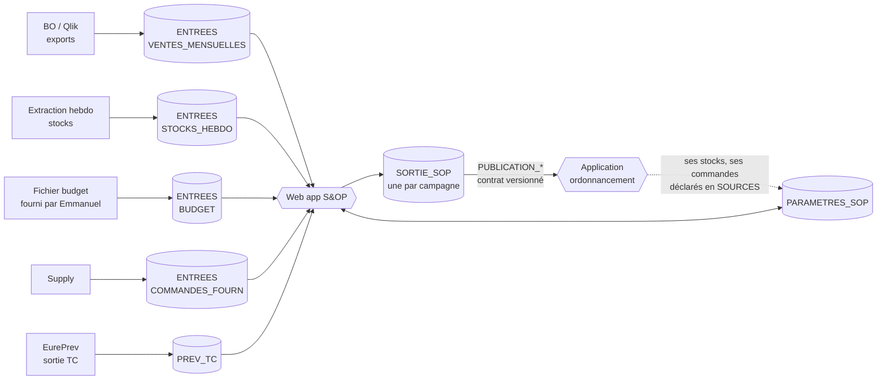

# Structure des feuilles Google Sheets – S&OP

Ce document décrit les classeurs de l'application S&OP (web app Apps Script). Il suit le modèle d'EurePrev : **un fichier de paramètres**, **un fichier de sortie**, et des fichiers d'entrée déclarés dans les paramètres. Les tableaux détaillés à la fin sont générés par `outils/structure.py`, qui produit aussi les en-têtes prêts à importer dans `modeles/`.

## 1. Vue d'ensemble

| Rôle | Fichier | Qui écrit | Durée de vie |
|---|---|---|---|
| Référentiels et réglages | **PARAMETRES_SOP** | Administrateur, responsables de marché, supply | Permanent |
| Données brutes | **ENTREES** (un fichier par flux) | Personnes ou exports automatiques, jamais l'application | Rafraîchi |
| Résultats et traces | **SORTIE_SOP** | L'application uniquement | Une par campagne, archivée ensuite |

Les autres applications (ordonnancement des commandes, EurePrev) ne lisent que les onglets `PUBLICATION_*` de la sortie et le fichier de paramètres. Elles ne touchent jamais à `PREVISION`.

## 2. Ce qui est repris d'EurePrev

| EurePrev | S&OP | Changement |
|---|---|---|
| CAMPAGNES | CAMPAGNES | Ajout du type (PAC1 à PAC4, MORTE_SAISON), de l'horizon |
| REGLAGES, PROFILS | REGLAGES, PROFILS | Nouveaux rôles (PREV, AM) et droits (arbitrage, validation, voir budget) |
| TC | TC | Identique : même codes, même e-mails |
| ACCES_PAC | ACCES | Ajout de Marche, Plateforme |
| PRODUITS_PAC (par campagne) | PRODUITS (permanent) + GAMME (par campagne) | Poids article et densité pour passer en tonnes |
| PLATEFORMES | AFFECTATION_PLATEFORME + PLATEFORMES | La liste des lieux de stockage devient un onglet à part |
| MENSUALISATION | COEFFICIENTS | Niveaux marché, famille, article, plateforme ; mois puis semaine du mois |
| SOURCES, ARBITRAGES | SOURCES, ARBITRAGES | SOURCES décrit aussi la nature du flux et son responsable |
| DONNEES, JOURNAL, OPERATIONS | PREVISION, JOURNAL, OPERATIONS | Même logique : verrou, reçus, auteur réel |

Le classeur EurePrev reste la source des prévisions des TC : la nature `PREV_TC` de l'onglet SOURCES pointe vers sa sortie.

## 3. Règles communes

- Codes produit, codes TC, identifiants : **texte**. Zéros initiaux conservés.
- Mois `AAAA-MM`. Semaine `AAAA-Sss` (ISO, lundi). Dates `AAAA-MM-JJ`.
- OUI / NON en majuscules. **Une cellule vide n'est pas zéro.**
- Unité de stock partout dans les données ; les **tonnes** sont calculées : quantité × poids article. Affichage `# ##0" T"` à l'article, `# ##0"T"` aux grosses mailles, comme demandé.
- Les libellés de données doivent écrire « Eureden » (charte). Les valeurs servant de clés (par exemple `Coop EUREDEN` dans `_Canal de distribution`) restent **identiques à la source** : c'est l'écran qui les affiche en « Eureden ».
- Aucune ligne de PREVISION, JOURNAL ou OPERATIONS n'est triée, insérée ou supprimée à la main.

## 4. Versions et reprévisions

Le besoin « garder la trace de chaque reprévision » est couvert à trois niveaux :

1. **PREVISION** contient uniquement la version courante, avec les colonnes par source côte à côte : historique corrigé, statistique, TC, événements, correction, arbitrée, validée.
2. **INSTANTANES** garde une photo de la quantité retenue à chaque figement de version. Cela permet de comparer v1, v2, v3.
3. **JOURNAL** garde chaque modification : ancienne valeur, nouvelle valeur, auteur, motif.

Une version validée est verrouillée. Le fichier `BUDGET` étant sensible, l'application masque ses colonnes aux rôles qui n'ont pas `Voir budget`.

## 5. Le contrat de publication

Les onglets `PUBLICATION_MENSUELLE` et `PUBLICATION_HEBDO` sont les seuls que les autres applications ont le droit de lire. Ils sont réécrits entièrement à chaque validation de version. `CONTRAT` décrit chaque colonne et porte un numéro de version. Une évolution du schéma incrémente ce numéro, ce qui évite de casser l'ordonnancement sans le prévenir.

- **Mensuel :** article × entité × plateforme × mois, sur l'horizon de la campagne.
- **Hebdomadaire :** même grain, sur 13 semaines (réglable). Le détail hebdomadaire plus long n'est pas stocké : l'application le recalcule à partir des coefficients de semaine du mois.

## 6. Volumes à surveiller

Un classeur Google Sheets est limité à 10 millions de cellules. EurePrev en utilise déjà environ 6,9 millions pour 175 745 lignes.

Estimation à confirmer avec les vraies données (hypothèses : 1 500 articles actifs, 3 plateformes en moyenne par article, 12 mois) :

| Onglet | Lignes | Colonnes | Cellules |
|---|---|---|---|
| PREVISION | 54 000 | 18 | ≈ 1,0 M |
| INSTANTANES (8 versions) | 432 000 | 3 | ≈ 1,3 M |
| PUBLICATION_MENSUELLE | 54 000 | 11 | ≈ 0,6 M |
| PUBLICATION_HEBDO (13 sem.) | 58 500 | 11 | ≈ 0,6 M |
| **Total SORTIE_SOP** | | | **≈ 3,5 M** |

C'est confortable. Le point sensible est `VENTES_MENSUELLES` à la maille article × TC × mois : c'est pourquoi les ventes sont réparties en **un fichier par année civile**, et non dans la sortie.

## 7. Points à valider avant de créer les fichiers

1. **Poids article :** disponible dans un Google Sheet (réponse reçue). Il est déclaré dans SOURCES avec la nature `POIDS_ARTICLE` et copié dans PRODUITS. Reste à fournir le lien et ses colonnes.
2. **Rattachement semaine → mois :** mois du jeudi de la semaine (validé).
3. **Grain de la prévision (validé) :** article × plateforme × mois. La prévision des TC est annuelle par TC et article ; le passage au mois et à la plateforme se fait via AFFECTATION_PLATEFORME et COEFFICIENTS.
4. **Qui définit les coefficients :** à décider (réponse reportée). L'onglet prévoit `Valide par` et un numéro de version.
5. **Rôles (validés) :** ADMIN, PREV, RM, AM, RT, CD, RBP, TC, SUPPLY. Le contrôle de gestion et la direction n'ont pas de rôle : ils reçoivent les exports du comité. Reste à confirmer ce que peut corriger chaque rôle.
6. **Fichier d'ordonnancement :** quand l'application d'ordonnancement existera, ses colonnes de lecture sont à ajouter à `CONTRAT`.
7. **Droits budget :** par défaut seuls ADMIN et PREV ont `Voir budget` (PROFILS). Accord d'Emmanuel à obtenir pour élargir.

# Détail des onglets

## Fichier PARAMETRES_SOP

### MODE_EMPLOI
Aide courte à l'intérieur du classeur.

| Colonne | Type | Règle ou exemple |
|---|---|---|
| Sujet | TEXTE |  |
| Instruction | TEXTE |  |

### CAMPAGNES
Une ligne par campagne S&OP. Exactement une ligne Selectionnee = OUI.

| Colonne | Type | Règle ou exemple |
|---|---|---|
| ID campagne | TEXTE | Ex. SOP_2027_PAC2. Unique. |
| Libelle | TEXTE |  |
| Type | LISTE | PAC1 | PAC2 | PAC3 | PAC4 | MORTE_SAISON |
| Annee prevision | ENTIER | Ex. 2027 |
| Annee N-1 | ENTIER |  |
| Annee N-2 | ENTIER |  |
| Debut | DATE | AAAA-MM-JJ |
| Fin | DATE | AAAA-MM-JJ |
| Mois debut horizon | TEXTE | AAAA-MM |
| Horizon mois | ENTIER | Ex. 12 |
| Statut | LISTE | PREPARATION | OUVERTE | GELEE | CLOTUREE |
| ID sortie | TEXTE | ID du fichier SORTIE_SOP de cette campagne |
| Selectionnee | OUI/NON |  |
| Commentaire | TEXTE |  |

### REGLAGES
Clé / valeur. Réglages globaux de l'application.

| Colonne | Type | Règle ou exemple |
|---|---|---|
| Cle | TEXTE | DOMAINES, UNITE_PIVOT, SEUIL_ECART_N1, COUVERTURE_MIN_MOIS, COUVERTURE_MAX_MOIS, PRECISION_QTE, PRECISION_TONNES, MAX_LOT, VERSION_REFERENTIEL, RATTACHEMENT_SEMAINE |
| Valeur | TEXTE |  |
| Commentaire | TEXTE |  |

### PROFILS
Droits par rôle. Un rôle donne des capacités ; le périmètre est dans ACCES.

| Colonne | Type | Règle ou exemple |
|---|---|---|
| Role | LISTE | ADMIN | PREV | RM | AM | RT | CD | RBP | TC | SUPPLY |
| Consultation | OUI/NON |  |
| Correction prevision | OUI/NON |  |
| Arbitrage | OUI/NON |  |
| Validation | OUI/NON | Fige une version |
| Correction historique | OUI/NON |  |
| Validation gamme | OUI/NON |  |
| Voir budget | OUI/NON | Données sensibles |
| Configuration | OUI/NON |  |
| Perimetre obligatoire | TEXTE | Ex. Territoire, Bassin, Marche, GLOBAL |

### ACCES
Une ligne = un accès. Chaque colonne remplie est une condition ; vide ou * = pas de restriction.

| Colonne | Type | Règle ou exemple |
|---|---|---|
| ID campagne | TEXTE |  |
| Email Google | TEXTE | @eureden.com |
| Role | LISTE | voir PROFILS |
| Code technicien | TEXTE | Rôle TC uniquement |
| Entite | TEXTE |  |
| Calendrier | TEXTE |  |
| Departement TC | TEXTE |  |
| Territoire TC | TEXTE |  |
| Bassin TC | TEXTE |  |
| Marche | TEXTE |  |
| Plateforme | TEXTE |  |
| Global | OUI/NON |  |
| Actif | OUI/NON |  |
| Commentaire | TEXTE |  |

### TC
Référentiel des techniciens. Même structure qu'EurePrev (permanent).

| Colonne | Type | Règle ou exemple |
|---|---|---|
| Code technicien | TEXTE | Texte, zéros initiaux conservés |
| Libelle technicien | TEXTE |  |
| Mail | TEXTE |  |
| Entite | TEXTE | Valeur exacte de _Canal de distribution |
| Calendrier | TEXTE |  |
| Departement TC | TEXTE |  |
| Territoire TC | TEXTE |  |
| Bassin TC | TEXTE |  |
| Actif | OUI/NON |  |
| Source | TEXTE |  |

### PRODUITS
Référentiel article, permanent. Une ligne par code produit et entité.

| Colonne | Type | Règle ou exemple |
|---|---|---|
| Code produit | TEXTE | Texte |
| Entite | TEXTE |  |
| Libelle produit | TEXTE |  |
| Niv1 | TEXTE |  |
| Niv2 | TEXTE |  |
| Niv3 | TEXTE |  |
| Famille | TEXTE |  |
| Groupe | TEXTE |  |
| Marche | TEXTE |  |
| Segment | TEXTE | PERF, REF, ACC, FLA conservés tels quels |
| Unite stock | TEXTE | U, KG, L, SAC... |
| Poids article | DECIMAL | Poids ou volume d'une unité de stock, en kg ou L |
| Unite poids | LISTE | KG | L |
| Densite | DECIMAL | Pour convertir L en kg ; vide si KG |
| Dose ha | DECIMAL | Reprise EurePrev |
| Coefficient | DECIMAL | Reprise EurePrev |
| Mode conversion | LISTE | DOSE_MULTIPLICATEUR | DOSE_DIVISEUR | SANS_SURFACE |
| Date fin de vie | DATE | Vide si actif |
| Actif | OUI/NON |  |
| Commentaire | TEXTE |  |

### GAMME
Gamme par campagne, validée par les responsables de marché.

| Colonne | Type | Règle ou exemple |
|---|---|---|
| ID campagne | TEXTE |  |
| Code produit | TEXTE |  |
| Entite | TEXTE |  |
| Dans la gamme | OUI/NON |  |
| Vendable hors gamme | OUI/NON |  |
| Validation | LISTE | A_VALIDER | VALIDE |
| Valide par | TEXTE |  |
| Valide le | DATE |  |

### SUBSTITUTIONS
Qui remplace qui, renseigné par les responsables de marché.

| Colonne | Type | Règle ou exemple |
|---|---|---|
| ID substitution | TEXTE |  |
| Code ancien | TEXTE |  |
| Code nouveau | TEXTE |  |
| Entite | TEXTE |  |
| Date effet | DATE |  |
| Taux de report | DECIMAL | % de l'historique de l'ancien repris sur le nouveau, 100 par défaut |
| Renseigne par | TEXTE |  |
| Valide par | TEXTE |  |
| Actif | OUI/NON |  |
| Commentaire | TEXTE |  |

### PLATEFORMES
Lieux de stockage. Un dépôt peut dépendre d'une plateforme (GLOMEL vers dépôts).

| Colonne | Type | Règle ou exemple |
|---|---|---|
| Plateforme | TEXTE | Code, ex. GLOMEL |
| Libelle | TEXTE |  |
| Type | LISTE | PLATEFORME | DEPOT | DEPOT_DEBORD |
| Plateforme parente | TEXTE | Alimente ce dépôt |
| Entite | TEXTE |  |
| Capacite T | DECIMAL | Saturation |
| Stock mini T | DECIMAL |  |
| Stock maxi T | DECIMAL |  |
| Actif | OUI/NON |  |

### AFFECTATION_PLATEFORME
Quelle plateforme sert quel bassin. Reprise de l'onglet PLATEFORMES d'EurePrev.

| Colonne | Type | Règle ou exemple |
|---|---|---|
| Entite | TEXTE |  |
| Territoire TC | TEXTE |  |
| Bassin TC | TEXTE |  |
| Plateforme | TEXTE |  |
| Validation | LISTE | A_VALIDER | VALIDE |
| Source | TEXTE |  |

### CALENDRIER
Semaines, mois et campagnes. Évite les calculs de dates dans l'application.

| Colonne | Type | Règle ou exemple |
|---|---|---|
| Semaine | TEXTE | AAAA-Sss (ISO) |
| Date debut | DATE | Lundi |
| Date fin | DATE | Dimanche |
| Mois rattache | TEXTE | AAAA-MM, règle REGLAGES / RATTACHEMENT_SEMAINE |
| Annee | ENTIER |  |
| Type campagne | TEXTE | PAC1 à PAC4 ou MORTE_SAISON |

### COEFFICIENTS
Cadençage : répartition d'un besoin annuel en mois, puis en semaines du mois.

| Colonne | Type | Règle ou exemple |
|---|---|---|
| ID campagne | TEXTE |  |
| Niveau | LISTE | MARCHE | FAMILLE | ARTICLE | PLATEFORME |
| Cle niveau | TEXTE | Valeur du niveau, ex. marché ENGRAIS |
| Plateforme | TEXTE | * = toutes |
| Granularite | LISTE | MOIS | SEMAINE_DU_MOIS |
| Periode | ENTIER | 1 à 12, ou 1 à 5 |
| Coefficient | DECIMAL | En %. Somme = 100 par ensemble |
| Origine | LISTE | HISTORIQUE | MANUEL |
| Version coefficients | ENTIER | Incrémentée à chaque modification |
| Validation | LISTE | A_VALIDER | VALIDE |
| Valide par | TEXTE |  |

### CONTRAINTES_APPRO
Fournisseurs, délais et conditions d'achat.

| Colonne | Type | Règle ou exemple |
|---|---|---|
| Code fournisseur | TEXTE |  |
| Libelle fournisseur | TEXTE |  |
| Marche | TEXTE |  |
| Code produit | TEXTE | Vide = tout le marché |
| Plateforme | TEXTE | * = toutes |
| Lead time semaines | ENTIER |  |
| Mini commande T | DECIMAL |  |
| Multiple commande T | DECIMAL | Ex. camion complet |
| Palier remise T | DECIMAL |  |
| Debut validite | DATE |  |
| Fin validite | DATE |  |
| Commentaire | TEXTE |  |

### SEUILS_ALERTES
Alertes automatiques.

| Colonne | Type | Règle ou exemple |
|---|---|---|
| Code alerte | LISTE | ECART_N1 | RUPTURE_PREVUE | SURSTOCK_PREVU | ECART_PREVISION | COUVERTURE_BASSE |
| Libelle | TEXTE |  |
| Seuil | DECIMAL |  |
| Unite seuil | TEXTE | %, mois, T |
| Perimetre | TEXTE | Marché, plateforme ou *  |
| Role destinataire | TEXTE |  |
| Actif | OUI/NON |  |

### SOURCES
Fichiers d'entrée alimentés par ailleurs. Une ligne par flux.

| Colonne | Type | Règle ou exemple |
|---|---|---|
| ID source | TEXTE |  |
| Nature | LISTE | VENTES | STOCKS | BUDGET | COMMANDES_FOURN | PREV_TC | POIDS_ARTICLE | ORDONNANCEMENT |
| ID fichier | TEXTE | ID Google Sheet natif |
| Onglet | TEXTE |  |
| Frequence | LISTE | HEBDO | MENSUEL | A_LA_DEMANDE |
| Mode alimentation | LISTE | MANUEL | EXPORT_BO | QLIK | AUTOMATIQUE | APPLICATION |
| Responsable | TEXTE |  |
| Sensible | OUI/NON |  |
| Derniere synchro | DATE | Écrite par l'application |
| Lignes | ENTIER |  |
| Actif import | OUI/NON |  |
| Commentaire | TEXTE |  |

### ARBITRAGES
Décisions de conception en attente ou validées (même principe qu'EurePrev).

| Colonne | Type | Règle ou exemple |
|---|---|---|
| Decision | TEXTE |  |
| Choix | TEXTE |  |
| Statut | LISTE | VALIDE_UTILISATEUR | PROPOSITION | A_VALIDER | A_COMPLETER |

## Fichiers d'entrée (un fichier par flux)

### VENTES_MENSUELLES
Ventes réalisées. Un fichier par année civile (volume). Déposé depuis BO.

| Colonne | Type | Règle ou exemple |
|---|---|---|
| Mois | TEXTE | AAAA-MM |
| Code produit | TEXTE |  |
| Entite | TEXTE |  |
| Code technicien | TEXTE |  |
| Bassin TC | TEXTE |  |
| Plateforme | TEXTE | Si connue |
| Quantite | DECIMAL | Unité de stock |
| Valeur euro | DECIMAL | Vide si inconnue |
| Source | TEXTE |  |

### STOCKS_HEBDO
Stock par plateforme, extraction hebdomadaire.

| Colonne | Type | Règle ou exemple |
|---|---|---|
| Date stock | DATE | Lundi |
| Plateforme | TEXTE |  |
| Code produit | TEXTE |  |
| Entite | TEXTE |  |
| Stock | DECIMAL | Unité de stock |
| Source | TEXTE |  |

### COMMANDES_FOURN
Commandes fournisseurs en cours.

| Colonne | Type | Règle ou exemple |
|---|---|---|
| N commande | TEXTE |  |
| Code fournisseur | TEXTE |  |
| Code produit | TEXTE |  |
| Plateforme | TEXTE |  |
| Date commande | DATE |  |
| Date livraison prevue | DATE |  |
| Quantite | DECIMAL | Unité de stock |
| Statut | LISTE | EN_COURS | LIVREE | ANNULEE |

### BUDGET
Budget par article et mois. Données sensibles, accès restreint.

| Colonne | Type | Règle ou exemple |
|---|---|---|
| Annee | ENTIER |  |
| Version budget | TEXTE |  |
| Mois | TEXTE | AAAA-MM |
| Code produit | TEXTE |  |
| Entite | TEXTE |  |
| Quantite | DECIMAL | Unité de stock |
| Valeur euro | DECIMAL |  |

## Fichier SORTIE_SOP (un par campagne)

### MODE_EMPLOI
Aide courte.

| Colonne | Type | Règle ou exemple |
|---|---|---|
| Sujet | TEXTE |  |
| Instruction | TEXTE |  |

### VERSIONS
Catalogue des versions de la campagne. Une version = un jeu complet de prévisions.

| Colonne | Type | Règle ou exemple |
|---|---|---|
| ID version | TEXTE | Ex. V004 |
| ID campagne | TEXTE |  |
| Numero | ENTIER |  |
| Type | LISTE | PREV_TC | STATISTIQUE | ARBITREE | VALIDEE |
| Libelle | TEXTE |  |
| Statut | LISTE | BROUILLON | COURANTE | ARCHIVEE |
| Date reunion S&OP | DATE |  |
| Version coefficients | ENTIER | Cadençage utilisé |
| Cree par | TEXTE |  |
| Cree le | DATE |  |
| Verrouillee | OUI/NON | OUI après validation |
| Commentaire | TEXTE |  |

### PREVISION
Version courante. Une ligne par article, entité, plateforme et mois.

| Colonne | Type | Règle ou exemple |
|---|---|---|
| ID ligne | TEXTE | campagne|entite|produit|plateforme|mois, composants encodés |
| Code produit | TEXTE |  |
| Entite | TEXTE |  |
| Plateforme | TEXTE |  |
| Mois | TEXTE | AAAA-MM |
| Qte historique corrigee N-1 | DECIMAL | Unité de stock |
| Qte statistique | DECIMAL |  |
| Qte TC | DECIMAL |  |
| Qte evenements | DECIMAL | Polco, promo, réglementaire |
| Qte correction | DECIMAL |  |
| Qte arbitree | DECIMAL |  |
| Qte validee | DECIMAL |  |
| Unite stock | TEXTE |  |
| Poids article | DECIMAL | Copié du référentiel |
| Statut | LISTE | PREV_TC | ARBITREE | VALIDEE |
| Version | TEXTE | ID version courante |
| Modifie par | TEXTE |  |
| Modifie le | DATE |  |

### INSTANTANES
Photo de la quantité retenue à chaque figement de version. Permet de comparer les reprévisions.

| Colonne | Type | Règle ou exemple |
|---|---|---|
| ID version | TEXTE |  |
| ID ligne | TEXTE |  |
| Qte retenue | DECIMAL | Arbitrée ou validée selon le type de version |

### CORRECTIONS_HISTO
Corrections de l'historique. Le brut n'est jamais écrasé.

| Colonne | Type | Règle ou exemple |
|---|---|---|
| ID correction | TEXTE |  |
| Code produit | TEXTE |  |
| Entite | TEXTE |  |
| Plateforme | TEXTE | * = toutes |
| Mois debut | TEXTE | AAAA-MM |
| Mois fin | TEXTE | AAAA-MM |
| Type | LISTE | RUPTURE | ANOMALIE | EVENEMENT | SUBSTITUTION | APPRO_FOURNISSEUR |
| Qte brute | DECIMAL |  |
| Qte corrigee | DECIMAL |  |
| Motif | TEXTE |  |
| Commentaire | TEXTE |  |
| Statut | LISTE | ACTIVE | ANNULEE |
| Cree par | TEXTE |  |
| Cree le | DATE |  |
| Annule par | TEXTE |  |
| Annule le | DATE |  |

### EVENEMENTS_COMMERCE
Apports du commerce à la prévision : polco, promotions, grands comptes, appels d'offres, réglementaire.

| Colonne | Type | Règle ou exemple |
|---|---|---|
| ID evenement | TEXTE |  |
| Type | LISTE | POLCO | PROMO | GRAND_COMPTE | APPEL_OFFRES | REGLEMENTAIRE |
| Code produit | TEXTE | Vide = tout le marché |
| Marche | TEXTE |  |
| Entite | TEXTE |  |
| Territoire TC | TEXTE | * = tous |
| Mois debut | TEXTE |  |
| Mois fin | TEXTE |  |
| Impact quantite | DECIMAL |  |
| Impact pourcent | DECIMAL | Un des deux impacts |
| Commentaire | TEXTE |  |
| Saisi par | TEXTE |  |
| Saisi le | DATE |  |
| Actif | OUI/NON |  |

### STOCKS_PROJETES
Projection hebdomadaire par plateforme et marché pour la version courante.

| Colonne | Type | Règle ou exemple |
|---|---|---|
| ID version | TEXTE |  |
| Semaine | TEXTE | AAAA-Sss |
| Plateforme | TEXTE |  |
| Marche | TEXTE |  |
| Stock debut T | DECIMAL |  |
| Sorties prevues T | DECIMAL |  |
| Entrees fournisseurs T | DECIMAL |  |
| Stock fin T | DECIMAL |  |
| Couverture mois | DECIMAL |  |
| Alerte | LISTE | AUCUNE | RUPTURE | SURSTOCK | SATURATION |

### FIABILITE
Écart entre prévu et réalisé, calculé à chaque clôture de mois.

| Colonne | Type | Règle ou exemple |
|---|---|---|
| ID campagne | TEXTE |  |
| Mois | TEXTE |  |
| Niveau | LISTE | MARCHE | PLATEFORME | GROUPE | ARTICLE | TERRITOIRE | BASSIN |
| Cle niveau | TEXTE |  |
| Version evaluee | TEXTE |  |
| Prevu T | DECIMAL |  |
| Realise T | DECIMAL |  |
| Ecart T | DECIMAL |  |
| Ecart pourcent | DECIMAL |  |
| Biais pourcent | DECIMAL | Signé, positif = sur-prévision |

### ALERTES
Alertes générées par l'application.

| Colonne | Type | Règle ou exemple |
|---|---|---|
| ID alerte | TEXTE |  |
| Date | DATE |  |
| Code alerte | TEXTE | Voir SEUILS_ALERTES |
| Cle | TEXTE | Marché, article ou plateforme concerné |
| Valeur | DECIMAL |  |
| Seuil | DECIMAL |  |
| Statut | LISTE | OUVERTE | ACQUITTEE |
| Acquittee par | TEXTE |  |
| Acquittee le | DATE |  |

### DECISIONS
Décisions prises en comité S&OP.

| Colonne | Type | Règle ou exemple |
|---|---|---|
| ID decision | TEXTE |  |
| Date reunion | DATE |  |
| Sujet | TEXTE |  |
| Decision | TEXTE |  |
| Decideurs | TEXTE | Collectif |
| ID version | TEXTE |  |
| Saisi par | TEXTE |  |

### JOURNAL
Trace de chaque modification (même principe qu'EurePrev).

| Colonne | Type | Règle ou exemple |
|---|---|---|
| Horodatage | DATE |  |
| Auteur | TEXTE | Email réel |
| Action | TEXTE |  |
| Objet | TEXTE | Onglet et clé |
| Ancienne valeur | TEXTE |  |
| Nouvelle valeur | TEXTE |  |
| Motif | TEXTE |  |
| ID operation | TEXTE |  |

### OPERATIONS
Reçus de sauvegarde pour rejouer un appel sans doublon.

| Colonne | Type | Règle ou exemple |
|---|---|---|
| ID operation | TEXTE |  |
| Auteur | TEXTE |  |
| Horodatage | DATE |  |
| Lignes | ENTIER |  |
| Resultat | TEXTE |  |

### CONTRAT
Description versionnée des onglets PUBLICATION_*. Les autres applications se fient à elle.

| Colonne | Type | Règle ou exemple |
|---|---|---|
| Onglet | TEXTE |  |
| Colonne | TEXTE |  |
| Type | TEXTE |  |
| Description | TEXTE |  |
| Version contrat | TEXTE | Ex. 1.0 |

### PUBLICATION_MENSUELLE
Contrat de sortie. Prévision validée mensuelle, lue par les autres applications. Écrite uniquement à la validation.

| Colonne | Type | Règle ou exemple |
|---|---|---|
| ID campagne | TEXTE |  |
| Version contrat | TEXTE |  |
| ID version | TEXTE |  |
| Date validation | DATE |  |
| Code produit | TEXTE |  |
| Entite | TEXTE |  |
| Plateforme | TEXTE |  |
| Mois | TEXTE | AAAA-MM |
| Quantite | DECIMAL | Unité de stock |
| Unite stock | TEXTE |  |
| Tonnes | DECIMAL | Quantité × poids article |

### PUBLICATION_HEBDO
Contrat de sortie. Prévision hebdomadaire sur l'horizon court (par défaut 13 semaines), pour l'ordonnancement.

| Colonne | Type | Règle ou exemple |
|---|---|---|
| ID campagne | TEXTE |  |
| Version contrat | TEXTE |  |
| ID version | TEXTE |  |
| Date validation | DATE |  |
| Code produit | TEXTE |  |
| Entite | TEXTE |  |
| Plateforme | TEXTE |  |
| Semaine | TEXTE | AAAA-Sss |
| Quantite | DECIMAL |  |
| Unite stock | TEXTE |  |
| Tonnes | DECIMAL |  |
