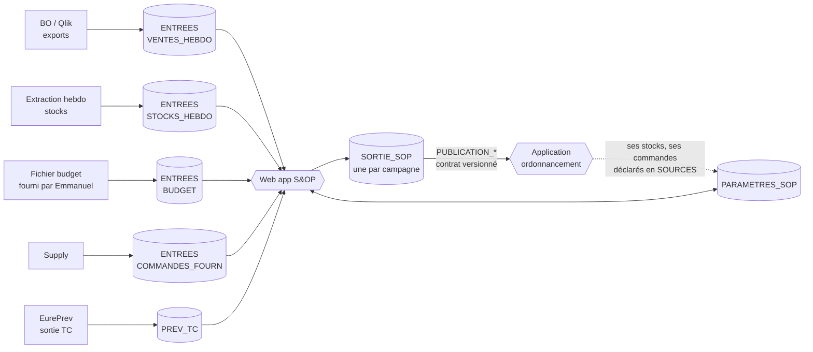

# Structure des feuilles Google Sheets – S&OP

Ce document décrit les classeurs de l'application S&OP (web app Apps Script). Il suit le modèle d'EurePrev : **un fichier de paramètres**, **un fichier de sortie**, et des fichiers d'entrée déclarés dans les paramètres. Les tableaux détaillés à la fin sont générés par `outils/structure.py`, qui produit aussi les en-têtes prêts à importer dans `modeles/`.

## 1. Vue d'ensemble

| Rôle | Fichier | Qui écrit | Durée de vie |
|---|---|---|---|
| Référentiels et réglages | **PARAMETRES_SOP** | Administrateur, responsables de marché, supply | Permanent |
| Données brutes | **ENTREES** (un fichier par flux) | Personnes ou exports automatiques, jamais l'application | Rafraîchi |
| Résultats et traces | **SORTIE_SOP** | L'application uniquement | Une par campagne, archivée ensuite |

Les autres applications (ordonnancement des commandes, EurePrev) ne lisent que les onglets `PUBLICATION_*` de la sortie et le fichier de paramètres. Elles ne touchent jamais à `PREVISION`.

## 2. Ce qui est repris d'EurePrev

| EurePrev | S&OP | Changement |
|---|---|---|
| CAMPAGNES | CAMPAGNES | Ajout du type (PAC1 à PAC4, MORTE_SAISON), de l'horizon |
| REGLAGES, PROFILS | REGLAGES, PROFILS | Nouveaux rôles (PREV, AM) et droits (arbitrage, validation, voir budget) |
| TC | TC | Identique : même codes, même e-mails |
| ACCES_PAC | ACCES | Ajout de Marche, Plateforme |
| PRODUITS_PAC (par campagne) | PRODUITS (permanent) + GAMME (par campagne) | Poids article et densité pour passer en tonnes |
| PLATEFORMES | AFFECTATION_PLATEFORME + PLATEFORMES | La liste des lieux de stockage devient un onglet à part |
| MENSUALISATION | COEFFICIENTS | Cadençage **à la semaine** (semaine ISO) ; niveaux marché, famille, article, plateforme |
| SOURCES, ARBITRAGES | SOURCES, ARBITRAGES | SOURCES décrit aussi la nature du flux et son responsable |
| DONNEES, JOURNAL, OPERATIONS | PREVISION, JOURNAL, OPERATIONS | Même logique : verrou, reçus, auteur réel |

Le classeur EurePrev reste la source des prévisions des TC : la nature `PREV_TC` de l'onglet SOURCES pointe vers sa sortie.

## 3. Règles communes

- Codes produit, codes TC, identifiants : **texte**. Zéros initiaux conservés.
- Mois `AAAA-MM`. Semaine `AAAA-Sss` (ISO, lundi). Dates `AAAA-MM-JJ`.
- OUI / NON en majuscules. **Une cellule vide n'est pas zéro.**
- Unité de stock partout dans les données ; les **tonnes** sont calculées : quantité × poids article. Affichage `# ##0" T"` à l'article, `# ##0"T"` aux grosses mailles, comme demandé.
- Les libellés de données doivent écrire « Eureden » (charte). Les valeurs servant de clés (par exemple `Coop EUREDEN` dans `_Canal de distribution`) restent **identiques à la source** : c'est l'écran qui les affiche en « Eureden ».
- Aucune ligne de PREVISION, JOURNAL ou OPERATIONS n'est triée, insérée ou supprimée à la main.

## 4. Versions et reprévisions

Le besoin « garder la trace de chaque reprévision » est couvert à trois niveaux :

1. **PREVISION** contient uniquement la version courante, avec les colonnes par source côte à côte : historique corrigé, statistique, TC, événements, correction, arbitrée, validée.
2. **INSTANTANES** garde une photo de la quantité retenue à chaque figement de version. Cela permet de comparer v1, v2, v3.
3. **JOURNAL** garde chaque modification : ancienne valeur, nouvelle valeur, auteur, motif.

Une version validée est verrouillée. Le fichier `BUDGET` étant sensible, l'application masque ses colonnes aux rôles qui n'ont pas `Voir budget`.

## 5. Le contrat de publication

Les onglets `PUBLICATION_MENSUELLE` et `PUBLICATION_HEBDO` sont les seuls que les autres applications ont le droit de lire. Ils sont réécrits entièrement à chaque validation de version. `CONTRAT` décrit chaque colonne et porte un numéro de version. Une évolution du schéma incrémente ce numéro, ce qui évite de casser l'ordonnancement sans le prévenir.

- **Mensuel :** article × entité × plateforme × mois, sur l'horizon de la campagne (somme des semaines).
- **Hebdomadaire :** même grain, sur l'horizon du suivi de stock actuel (78 semaines par défaut, réglable). Il ne porte que sur les articles suivis en stock, quelques dizaines par plateforme.

## 6. Le suivi de stock (modèle observé dans vos fichiers)

Votre suivi actuel (onglet GLOMEL v3) projette, pour chaque article et chaque semaine, ces mouvements. Environ 40 articles sur Glomel, de la semaine 32 de 2025 à la semaine 26 de 2027.

| Mouvement | Nature | D'où vient la donnée |
|---|---|---|
| STOCK_DEBUT | Calculé | Stock de fin de la semaine précédente. Première semaine : STOCKS_HEBDO |
| ACHATS | Entrée | COMMANDES_FOURN, reste à livrer, à la date limite de livraison |
| BESOIN_REAPPRO | **Sortie du calcul** | Quantité à commander pour tenir le stock mini (PARAMETRES_STOCK) |
| RETOURS_MAGASINS | Entrée | Estimé (à préciser) |
| TRANSFERT_ENTRANT | Entrée | Autre plateforme, via ROUTES_APPRO (ex. transfert de Gruel Fayer) |
| VENTES_PREV | Sortie | Prévision arbitrée de la semaine, une ligne par entité (Coop, ONA) |
| REPORT_VENTES | Entrée ou sortie | SUBSTITUTIONS : flufénacet, arrêt Minarix |
| STOCK_FIN | Calculé | Début + entrées − sorties |

### Capacités et approvisionnement cadencé

Les capacités sont décrites dans `CAPACITES` : par plateforme, et si besoin par famille, groupe ou marché (stockage séparé des produits dangereux, par exemple). Trois types de capacité :

| Type | Ce qu'il limite |
|---|---|
| STOCKAGE | Le stock présent en même temps sur la plateforme (ou la famille) |
| RECEPTION_HEBDO | Ce qui peut être reçu en une semaine |
| EXPEDITION_HEBDO | Ce qui peut être sorti en une semaine |

L'unité est la **tonne, le kg, le litre ou l'unité**, au choix pour chaque ligne. L'application convertit chaque article avec son poids ou son volume (`PRODUITS` : poids article, unité du poids, densité). Un article qu'on ne peut pas convertir dans l'unité de la capacité est signalé en contrôle.

**Zones et articles dangereux.** Une zone est une partie d'une plateforme, par exemple Cevezo 2 à Glomel (`PLATEFORMES`, type ZONE, plateforme parente GLOMEL). `PRODUITS` indique si un article est dangereux, et `REGLES_STOCKAGE` l'oriente vers la bonne zone : les articles dangereux vont en Cevezo 2, obligatoirement ou de préférence. La zone a sa propre capacité dans `CAPACITES`, en plus de celle de la plateforme. Une capacité peut changer selon la saison (début et fin de validité). Les limites s'additionnent : la plateforme, ses zones, ses familles et ses articles dangereux doivent toutes être respectées.

L'application calcule les commandes en plusieurs passes, article par article puis plateforme par plateforme :

1. **Besoin brut** : la semaine où le stock projeté passerait sous le mini (`PARAMETRES_STOCK`), dans la vue réel.
2. **Contraintes d'achat** : minimum de commande, multiple (camion complet), palier de remise, délai du fournisseur (`CONTRAINTES_APPRO`). Cela donne la semaine de commande.
3. **Contrôle des capacités** : charge projetée par semaine, plateforme et famille (`OCCUPATION_PROJETEE`).
4. **Cadençage** : si une semaine dépasse la capacité de réception ou de stockage, l'application fractionne la livraison, l'avance ou la retarde dans les limites autorisées (« Avance max » et « Retard max » par fournisseur et article). Le stock débord des dépôts compte comme capacité supplémentaire.
5. **Demandes de décalage** : une commande peut être décalée à la demande du **client** ou de la **logistique**. Les personnes autorisées dépendent de la période de campagne (PAC 1 à PAC 4, morte saison) : elles sont listées dans `DECIDEURS_APPRO`, avec leur pouvoir (demander ou accepter). Chaque demande et sa décision sont gardées dans `DEMANDES_DECALAGE`. Une date imposée (verrouillée) n'est plus déplacée par le calcul.
6. **Résultat** : `PLAN_APPRO` garde pour chaque commande la quantité brute, la quantité proposée, le décalage et les contraintes qui ont joué. Les commandes validées sont publiées aux achats et à l'ordonnancement (`PUBLICATION_APPRO`).

Une saturation prévue qu'aucun décalage autorisé ne résout est signalée par l'alerte SATURATION_PREVUE : c'est une décision à prendre en comité (augmenter la capacité, utiliser un dépôt de débord, décaler une campagne).

### Ruptures : lire la demande et le réel en parallèle

Une rupture ne supprime pas la demande. L'application garde donc deux lectures de la même prévision :

| | Vue DEMANDE | Vue REEL |
|---|---|---|
| Question | Que se passerait-il si l'article était disponible ? | Que va-t-il vraiment se passer ? |
| Ventes | La prévision arbitrée, sans contrainte | Plafonnées par le stock disponible pendant la rupture |
| Stock | Peut devenir négatif : le négatif est le manque à combler | Plancher à zéro |
| Ventes non réalisées | Aucune | Affichées en VENTES_PERDUES, ou reportées plus tard, ou transférées à un substitut |

Chaque rupture est déclarée dans l'onglet `RUPTURES` : article, plateforme, semaines de début et de fin, cause, et **traitement des ventes** :

- **PERDUES** : elles disparaissent du réel et restent visibles comme ventes perdues.
- **REPORTEES** : un taux de ventes revient à une semaine de retour fixée. Le report apparaît en REPORT_VENTES.
- **SUBSTITUEES** : un taux passe sur un autre article, par le même mécanisme que SUBSTITUTIONS.

Dans le passé, c'est CORRECTIONS_HISTO (type RUPTURE) : la quantité brute est ce qui a été vendu, la quantité corrigée est la demande estimée. Le brut n'est jamais écrasé. Les prévisions statistiques se calculent sur l'historique corrigé.

Une rupture prévue est proposée automatiquement par l'application dès que le stock projeté passe sous zéro (alerte RUPTURE_PREVUE). Le prévisionniste confirme, choisit le traitement, ou rejette. Les deux quantités sont publiées aux autres applications (`Quantite demande`, `Quantite reelle`). La vue DEMANDE du stock n'est stockée que pour les articles qui ont une rupture.

Les lignes « Ventes prévisionnelles ONA » du suivi deviennent une ligne VENTES_PREV avec `Entite = ONA`, pas un mouvement à part.

## 7. Volumes à surveiller

Un classeur Google Sheets est limité à 10 millions de cellules. EurePrev en utilise déjà environ 6,9 millions pour 175 745 lignes.

Le cadençage est hebdomadaire, mais la prévision n'est **pas** stockée à la semaine : on stocke le besoin sur l'horizon de la campagne par article, entité et plateforme, et l'application le répartit par semaine avec `COEFFICIENTS` et `AJUSTEMENTS_SEMAINE`. Stocker 234 000 lignes hebdomadaires dans PREVISION, plus des photos par version, dépasserait la limite.

Estimation à confirmer avec les vraies données. Hypothèses : 1 500 articles actifs avec 3 plateformes en moyenne ; 80 articles suivis en stock sur 3 plateformes, sur 78 semaines et 9 mouvements ; 8 versions.

| Onglet | Lignes | Colonnes | Cellules |
|---|---|---|---|
| PREVISION | 4 500 | 20 | ≈ 0,1 M |
| INSTANTANES (8 versions) | 36 000 | 3 | ≈ 0,1 M |
| PUBLICATION_MENSUELLE (tous articles) | 54 000 | 14 | ≈ 0,8 M |
| PUBLICATION_HEBDO (articles suivis) | 18 700 | 14 | ≈ 0,3 M |
| STOCKS_PROJETES (version courante) | 170 000 | 10 | ≈ 1,7 M |
| PLAN_APPRO, OCCUPATION_PROJETEE | 10 000 | 12 | ≈ 0,1 M |
| **Total SORTIE_SOP** | | | **≈ 3,1 M** |

Si vous voulez publier **tous** les articles à la semaine (réglage `PUBLICATION_HEBDO_TOUS`), ajoutez environ 5 M de cellules : à décider avec l'ordonnancement.

Le point sensible reste `VENTES_HEBDO` : l'export actuel est à la ligne facturée, il doit être agrégé par semaine, article et point avant dépôt. Les ventes restent en **un fichier par année civile**.

## 8. Points à valider avant de créer les fichiers

1. **Poids article :** disponible dans un Google Sheet (réponse reçue). Il est déclaré dans SOURCES avec la nature `POIDS_ARTICLE` et copié dans PRODUITS. Reste à fournir le lien et ses colonnes.
2. **Rattachement semaine → mois :** mois du jeudi de la semaine (validé).
3. **Cadençage (validé) :** à la semaine. Le besoin est stocké par article, entité et plateforme sur l'horizon, réparti par semaine par l'application. Le comité lit les mois en additionnant les semaines (mois du jeudi). Reste à choisir la pondération des années et le lissage (REGLAGES, valeurs de départ proposées). La prévision des TC est annuelle par TC et article ; le passage au mois et à la plateforme se fait via AFFECTATION_PLATEFORME et COEFFICIENTS.
4. **Qui définit les coefficients :** à décider (réponse reportée). L'onglet prévoit `Valide par` et un numéro de version.
5. **Rôles (validés) :** ADMIN, PREV, RM, AM, RT, CD, RBP, TC, SUPPLY. Le contrôle de gestion et la direction n'ont pas de rôle : ils reçoivent les exports du comité. Reste à confirmer ce que peut corriger chaque rôle.
6. **Fichier d'ordonnancement :** quand l'application d'ordonnancement existera, ses colonnes de lecture sont à ajouter à `CONTRAT`.
7. **Capacités (validé) :** unités tonnes, kg, litres et unités ; détail par plateforme, zone (Cevezo 2), famille et article dangereux. Restent à fournir : les capacités chiffrées, la liste des articles dangereux, et les noms des décideurs de décalage par période de campagne.
8. **Droits budget :** par défaut seuls ADMIN et PREV ont `Voir budget` (PROFILS). Accord d'Emmanuel à obtenir pour élargir.
9. **À clarifier :** date de référence des ventes (commande ou livraison), sens de « PAC/PAL », sens de « HS GLOMEL », unité des quantités du suivi de stock, doublon « Besoin de Réappro » sur COLZOR TRIO 20 L.

# Détail des onglets

## Fichier PARAMETRES_SOP

### MODE_EMPLOI
Aide courte à l'intérieur du classeur.

| Colonne | Type | Règle ou exemple |
|---|---|---|
| Sujet | TEXTE |  |
| Instruction | TEXTE |  |

### CAMPAGNES
Une ligne par campagne S&OP. Exactement une ligne Selectionnee = OUI.

| Colonne | Type | Règle ou exemple |
|---|---|---|
| ID campagne | TEXTE | Ex. SOP_2027_PAC2. Unique. |
| Libelle | TEXTE |  |
| Type | LISTE | PAC1 | PAC2 | PAC3 | PAC4 | MORTE_SAISON |
| Annee prevision | ENTIER | Ex. 2027 |
| Annee N-1 | ENTIER |  |
| Annee N-2 | ENTIER |  |
| Debut | DATE | AAAA-MM-JJ |
| Fin | DATE | AAAA-MM-JJ |
| Mois debut horizon | TEXTE | AAAA-MM |
| Horizon mois | ENTIER | Ex. 12 |
| Statut | LISTE | PREPARATION | OUVERTE | GELEE | CLOTUREE |
| ID sortie | TEXTE | ID du fichier SORTIE_SOP de cette campagne |
| Selectionnee | OUI/NON |  |
| Commentaire | TEXTE |  |

### REGLAGES
Clé / valeur. Réglages globaux de l'application.

| Colonne | Type | Règle ou exemple |
|---|---|---|
| Cle | TEXTE | DOMAINES, UNITE_PIVOT, SEUIL_ECART_N1, COUVERTURE_MIN_MOIS, COUVERTURE_MAX_MOIS, HORIZON_HEBDO_SEMAINES, PONDERATION_ANNEES, ALPHA_LISSAGE, PUBLICATION_HEBDO_TOUS, PRECISION_QTE, PRECISION_TONNES, MAX_LOT, VERSION_REFERENTIEL, RATTACHEMENT_SEMAINE |
| Valeur | TEXTE |  |
| Commentaire | TEXTE |  |

### PROFILS
Droits par rôle. Un rôle donne des capacités ; le périmètre est dans ACCES.

| Colonne | Type | Règle ou exemple |
|---|---|---|
| Role | LISTE | ADMIN | PREV | RM | AM | RT | CD | RBP | TC | SUPPLY |
| Consultation | OUI/NON |  |
| Correction prevision | OUI/NON |  |
| Arbitrage | OUI/NON |  |
| Validation | OUI/NON | Fige une version |
| Correction historique | OUI/NON |  |
| Validation gamme | OUI/NON |  |
| Voir budget | OUI/NON | Données sensibles |
| Configuration | OUI/NON |  |
| Perimetre obligatoire | TEXTE | Ex. Territoire, Bassin, Marche, GLOBAL |

### ACCES
Une ligne = un accès. Chaque colonne remplie est une condition ; vide ou * = pas de restriction.

| Colonne | Type | Règle ou exemple |
|---|---|---|
| ID campagne | TEXTE |  |
| Email Google | TEXTE | @eureden.com |
| Role | LISTE | voir PROFILS |
| Code technicien | TEXTE | Rôle TC uniquement |
| Entite | TEXTE |  |
| Calendrier | TEXTE |  |
| Departement TC | TEXTE |  |
| Territoire TC | TEXTE |  |
| Bassin TC | TEXTE |  |
| Marche | TEXTE |  |
| Plateforme | TEXTE |  |
| Global | OUI/NON |  |
| Actif | OUI/NON |  |
| Commentaire | TEXTE |  |

### TC
Référentiel des techniciens. Même structure qu'EurePrev (permanent).

| Colonne | Type | Règle ou exemple |
|---|---|---|
| Code technicien | TEXTE | Texte, zéros initiaux conservés |
| Libelle technicien | TEXTE |  |
| Mail | TEXTE |  |
| Entite | TEXTE | Valeur exacte de _Canal de distribution |
| Calendrier | TEXTE |  |
| Departement TC | TEXTE |  |
| Territoire TC | TEXTE |  |
| Bassin TC | TEXTE |  |
| Actif | OUI/NON |  |
| Source | TEXTE |  |

### PRODUITS
Référentiel article, permanent. Une ligne par code produit et entité.

| Colonne | Type | Règle ou exemple |
|---|---|---|
| Code produit | TEXTE | Texte |
| Entite | TEXTE |  |
| Libelle produit | TEXTE |  |
| Niv1 | TEXTE |  |
| Niv2 | TEXTE |  |
| Niv3 | TEXTE |  |
| Niv4 | TEXTE |  |
| Famille | TEXTE |  |
| Groupe | TEXTE |  |
| Marche | TEXTE |  |
| Sous marche | TEXTE |  |
| Segment | TEXTE | PERF, REF, ACC, FLA conservés tels quels |
| Unite stock | TEXTE | U, KG, L, SAC... |
| Dangereux | OUI/NON | Doit être stocké en zone dangereuse (ex. Cevezo 2 à Glomel) |
| Classe danger | TEXTE | Classe ADR ou code ONU, si connue |
| Poids article | DECIMAL | Poids ou volume d'une unité de stock, en kg ou L |
| Source poids | TEXTE | Poids de réf, Poids brut, Poids unitaire : règle de priorité à fixer |
| Unite poids | LISTE | KG | L |
| Densite | DECIMAL | Pour convertir L en kg ; vide si KG |
| Dose ha | DECIMAL | Reprise EurePrev |
| Coefficient | DECIMAL | Reprise EurePrev |
| Mode conversion | LISTE | DOSE_MULTIPLICATEUR | DOSE_DIVISEUR | SANS_SURFACE |
| Date fin de vie | DATE | Vide si actif |
| Actif | OUI/NON |  |
| Commentaire | TEXTE |  |

### GAMME
Gamme par campagne, validée par les responsables de marché.

| Colonne | Type | Règle ou exemple |
|---|---|---|
| ID campagne | TEXTE |  |
| Code produit | TEXTE |  |
| Entite | TEXTE |  |
| Dans la gamme | OUI/NON |  |
| Vendable hors gamme | OUI/NON |  |
| Validation | LISTE | A_VALIDER | VALIDE |
| Valide par | TEXTE |  |
| Valide le | DATE |  |

### SUBSTITUTIONS
Remplacements et reports de ventes entre articles, renseignés par les responsables de marché. Vaut pour l'historique et pour la prévision.

| Colonne | Type | Règle ou exemple |
|---|---|---|
| ID substitution | TEXTE |  |
| Code ancien | TEXTE | Article qui disparaît ou perd ses ventes |
| Code nouveau | TEXTE | Article qui reçoit le report |
| Entite | TEXTE |  |
| Portee | LISTE | HISTORIQUE | PREVISION | LES_DEUX |
| Motif | LISTE | REMPLACEMENT | ARRET | REGLEMENTAIRE | AUTRE |
| Date effet | DATE |  |
| Date fin | DATE | Vide si sans fin |
| Taux de report | DECIMAL | % des ventes de l'ancien reportées sur le nouveau, 100 par défaut |
| Renseigne par | TEXTE |  |
| Valide par | TEXTE |  |
| Actif | OUI/NON |  |
| Commentaire | TEXTE | Ex. arrêt Minarix, report flufénacet |

### PLATEFORMES
Lieux de stockage. Un dépôt peut dépendre d'une plateforme (GLOMEL vers dépôts) et une zone est une partie d'une plateforme (Cevezo 2 à Glomel). Les capacités sont dans CAPACITES.

| Colonne | Type | Règle ou exemple |
|---|---|---|
| Plateforme | TEXTE | Code, ex. GLOMEL |
| Libelle | TEXTE |  |
| Type | LISTE | PLATEFORME | DEPOT | DEPOT_DEBORD | ZONE |
| Plateforme parente | TEXTE | Alimente ce dépôt, ou plateforme qui contient la zone (CEVEZO2 pour GLOMEL) |
| Entite | TEXTE |  |
| Actif | OUI/NON |  |

### CAPACITES
Capacités par plateforme, avec ou sans détail par famille. Plusieurs lignes possibles par plateforme et par période.

| Colonne | Type | Règle ou exemple |
|---|---|---|
| Plateforme | TEXTE | Plateforme, dépôt ou zone |
| Niveau | LISTE | PLATEFORME | ZONE | GROUPE | FAMILLE | MARCHE | ARTICLE | DANGEREUX |
| Cle niveau | TEXTE | * pour le total, sinon le groupe, la famille, le marché, le code article. OUI pour DANGEREUX |
| Type capacite | LISTE | STOCKAGE | RECEPTION_HEBDO | EXPEDITION_HEBDO |
| Unite | LISTE | T | KG | L | U |
| Capacite | DECIMAL | Valeur maximale dans l'unité |
| Seuil alerte pourcent | DECIMAL | Alerte au-delà de ce taux, ex. 90 |
| Debut validite | DATE | Vide = toujours. Permet une capacité saisonnière |
| Fin validite | DATE |  |
| Commentaire | TEXTE | Ex. stockage séparé des produits dangereux |

### REGLES_STOCKAGE
Où stocker quoi : les articles dangereux, une famille ou un article sont orientés vers une zone.

| Colonne | Type | Règle ou exemple |
|---|---|---|
| Plateforme | TEXTE | Ex. GLOMEL |
| Zone | TEXTE | Ex. CEVEZO2 |
| Critere | LISTE | DANGEREUX | FAMILLE | MARCHE | ARTICLE |
| Valeur critere | TEXTE | OUI pour DANGEREUX, sinon le code |
| Mode | LISTE | OBLIGATOIRE | PREFERE |
| Actif | OUI/NON |  |

### AFFECTATION_PLATEFORME
Quelle plateforme sert quel bassin. Reprise de l'onglet PLATEFORMES d'EurePrev.

| Colonne | Type | Règle ou exemple |
|---|---|---|
| Entite | TEXTE |  |
| Territoire TC | TEXTE |  |
| Bassin TC | TEXTE |  |
| Plateforme | TEXTE | Plateforme rattachée |
| Km | DECIMAL | Distance bassin vers cette plateforme |
| Validation | LISTE | A_VALIDER | VALIDE |
| Source | TEXTE |  |

### FORCAGES
Livraisons faites depuis une autre plateforme que la plateforme rattachée.

| Colonne | Type | Règle ou exemple |
|---|---|---|
| Entite | TEXTE |  |
| Bassin TC | TEXTE |  |
| Code produit | TEXTE | Vide = tout le marché |
| Plateforme rattachee | TEXTE |  |
| Plateforme forcee | TEXTE |  |
| Debut | DATE |  |
| Fin | DATE |  |
| Motif | TEXTE |  |
| Actif | OUI/NON |  |

### POINTS
Points de départ des livraisons (bases de proximité, magasins). Les magasins sont regroupés.

| Colonne | Type | Règle ou exemple |
|---|---|---|
| Code point | TEXTE | « Départ depuis » dans BO, « Code du point » dans les achats |
| Libelle point | TEXTE |  |
| Type point | LISTE | BDP | AB | KORIT | MAGASIN | AUTRE |
| Groupe magasins | TEXTE | Regroupement demandé pour les magasins |
| Bassin TC | TEXTE |  |
| Plateforme rattachee | TEXTE |  |
| Actif | OUI/NON |  |

### CALENDRIER
Semaines, mois et campagnes. Évite les calculs de dates dans l'application.

| Colonne | Type | Règle ou exemple |
|---|---|---|
| Semaine | TEXTE | AAAA-Sss (ISO) |
| Date debut | DATE | Lundi |
| Date fin | DATE | Dimanche |
| Mois rattache | TEXTE | AAAA-MM, règle REGLAGES / RATTACHEMENT_SEMAINE |
| Annee | ENTIER |  |
| Type campagne | TEXTE | PAC1 à PAC4 ou MORTE_SAISON |

### COEFFICIENTS
Cadençage : répartition du besoin annuel sur les semaines. Les mois du comité s'obtiennent en additionnant les semaines.

| Colonne | Type | Règle ou exemple |
|---|---|---|
| ID campagne | TEXTE |  |
| Niveau | LISTE | MARCHE | FAMILLE | ARTICLE | PLATEFORME |
| Cle niveau | TEXTE | Valeur du niveau, ex. marché ENGRAIS |
| Plateforme | TEXTE | * = toutes |
| Semaine | ENTIER | Numéro de semaine ISO, 1 à 53 |
| Coefficient | DECIMAL | En % du besoin annuel. Somme = 100 par ensemble Niveau, Cle niveau, Plateforme |
| Origine | LISTE | HISTORIQUE | BUDGET | MANUEL |
| Version coefficients | ENTIER | Incrémentée à chaque modification |
| Validation | LISTE | A_VALIDER | VALIDE |
| Valide par | TEXTE |  |

### CONTRAINTES_APPRO
Fournisseurs, délais et conditions d'achat.

| Colonne | Type | Règle ou exemple |
|---|---|---|
| Code fournisseur | TEXTE |  |
| Libelle fournisseur | TEXTE |  |
| Marche | TEXTE |  |
| Code produit | TEXTE | Vide = tout le marché |
| Plateforme | TEXTE | * = toutes |
| Lead time semaines | ENTIER |  |
| Mini commande T | DECIMAL |  |
| Multiple commande T | DECIMAL | Ex. camion complet |
| Palier remise T | DECIMAL |  |
| Avance max semaines | ENTIER | De combien on peut avancer une livraison pour respecter une capacité |
| Retard max semaines | ENTIER | De combien on peut la retarder sans risque de rupture |
| Debut validite | DATE |  |
| Fin validite | DATE |  |
| Commentaire | TEXTE |  |

### DECIDEURS_APPRO
Qui peut demander ou accepter un décalage de commande, selon la période de campagne. Une demande vient du client ou de la logistique.

| Colonne | Type | Règle ou exemple |
|---|---|---|
| Type campagne | LISTE | PAC1 | PAC2 | PAC3 | PAC4 | MORTE_SAISON |
| Marche | TEXTE | * = tous |
| Plateforme | TEXTE | * = toutes |
| Email Google | TEXTE |  |
| Pouvoir | LISTE | DEMANDER | ACCEPTER |
| Origine represente | LISTE | CLIENT | LOGISTIQUE |
| Actif | OUI/NON |  |

### ROUTES_APPRO
D'où vient le stock d'un article sur une plateforme : fournisseur ou transfert depuis une autre plateforme.

| Colonne | Type | Règle ou exemple |
|---|---|---|
| Plateforme | TEXTE | Destination |
| Code produit | TEXTE | Vide = tout le marché |
| Marche | TEXTE |  |
| Type source | LISTE | FOURNISSEUR | PLATEFORME |
| Code source | TEXTE | Code fournisseur ou plateforme d'origine, ex. GRUEL |
| Delai semaines | ENTIER |  |
| Actif | OUI/NON |  |
| Commentaire | TEXTE |  |

### PARAMETRES_STOCK
Seuils de stock par article et plateforme. Servent à calculer le besoin de réapprovisionnement.

| Colonne | Type | Règle ou exemple |
|---|---|---|
| Plateforme | TEXTE |  |
| Code produit | TEXTE |  |
| Stock mini | DECIMAL | Unité de stock |
| Stock cible | DECIMAL |  |
| Lot reappro | DECIMAL | Taille de lot ou palier d'achat |
| Actif | OUI/NON |  |

### SEUILS_ALERTES
Alertes automatiques.

| Colonne | Type | Règle ou exemple |
|---|---|---|
| Code alerte | LISTE | ECART_N1 | RUPTURE_PREVUE | SURSTOCK_PREVU | SATURATION_PREVUE | ECART_PREVISION | COUVERTURE_BASSE |
| Libelle | TEXTE |  |
| Seuil | DECIMAL |  |
| Unite seuil | TEXTE | %, mois, T |
| Perimetre | TEXTE | Marché, plateforme ou *  |
| Role destinataire | TEXTE |  |
| Actif | OUI/NON |  |

### SOURCES
Fichiers d'entrée alimentés par ailleurs. Une ligne par flux.

| Colonne | Type | Règle ou exemple |
|---|---|---|
| ID source | TEXTE |  |
| Nature | LISTE | HISTO_PAC | VENTES | STOCKS | BUDGET | COMMANDES_FOURN | PREV_TC | POIDS_ARTICLE | ORDONNANCEMENT |
| ID fichier | TEXTE | ID Google Sheet natif |
| Onglet | TEXTE |  |
| Frequence | LISTE | HEBDO | MENSUEL | A_LA_DEMANDE |
| Mode alimentation | LISTE | MANUEL | EXPORT_BO | QLIK | AUTOMATIQUE | APPLICATION |
| Responsable | TEXTE |  |
| Sensible | OUI/NON |  |
| Derniere synchro | DATE | Écrite par l'application |
| Lignes | ENTIER |  |
| Actif import | OUI/NON |  |
| Commentaire | TEXTE |  |
| ID campagne | TEXTE | Vide = valable pour toutes les campagnes |
| Entite | TEXTE | HISTO_PAC : entité du fichier, ex. Coop EUREDEN |
| PAC | TEXTE | HISTO_PAC : PAC1 à PAC4 |
| Annees | TEXTE | HISTO_PAC : années lues, ex. 2024,2025,2026. Onglet = modèle avec {ANNEE} |
| Format | LISTE | SHEETS (Google Sheets natif) | XLSX (à convertir) |

### ARBITRAGES
Décisions de conception en attente ou validées (même principe qu'EurePrev).

| Colonne | Type | Règle ou exemple |
|---|---|---|
| Decision | TEXTE |  |
| Choix | TEXTE |  |
| Statut | LISTE | VALIDE_UTILISATEUR | PROPOSITION | A_VALIDER | A_COMPLETER |

## Fichiers d'entrée (un fichier par flux)

### VENTES_HEBDO
Ventes réalisées, agrégées par semaine de livraison, article et point de départ. Un fichier par année civile. Déposé depuis BO ou Qlik.

| Colonne | Type | Règle ou exemple |
|---|---|---|
| Semaine livraison | TEXTE | AAAA-Sss |
| Semaine commande | TEXTE | Vide si inconnue |
| Code produit | TEXTE |  |
| Code point | TEXTE | Départ depuis |
| Entite | TEXTE |  |
| Bassin TC | TEXTE |  |
| Plateforme rattachee | TEXTE |  |
| Plateforme forcee | TEXTE | Si livraison forcée |
| PAC | TEXTE | Campagne de rattachement |
| Reference PAC PAL | TEXTE | Sens à confirmer |
| Quantite | DECIMAL | Unité de stock |
| Poids total kg | DECIMAL |  |
| Valeur euro | DECIMAL |  |
| Source | TEXTE |  |

### STOCKS_HEBDO
Stock par plateforme, extraction hebdomadaire.

| Colonne | Type | Règle ou exemple |
|---|---|---|
| Date stock | DATE | Lundi |
| Plateforme | TEXTE |  |
| Code produit | TEXTE |  |
| Entite | TEXTE |  |
| Stock | DECIMAL | Unité de stock |
| Source | TEXTE |  |

### COMMANDES_FOURN
Commandes fournisseurs (commandes d'achat), extraction ERP.

| Colonne | Type | Règle ou exemple |
|---|---|---|
| N commande | TEXTE |  |
| N commande vente associee | TEXTE | Vide si achat pour stock |
| Code fournisseur | TEXTE |  |
| Nom fournisseur | TEXTE |  |
| Societe partenaire | TEXTE |  |
| Code produit | TEXTE |  |
| Code point | TEXTE | Plateforme de livraison |
| Date commande | DATE |  |
| Date limite livraison | DATE |  |
| Etat | TEXTE | Valeurs de l'ERP à lister |
| Quantite commandee | DECIMAL | Unité de stock |
| Quantite receptionnee | DECIMAL |  |
| Quantite reste a livrer | DECIMAL |  |
| Prix unitaire | DECIMAL |  |

### BUDGET
Budget par article et mois. Données sensibles, accès restreint.

| Colonne | Type | Règle ou exemple |
|---|---|---|
| Annee | ENTIER |  |
| Version budget | TEXTE |  |
| Mois | TEXTE | AAAA-MM |
| Code produit | TEXTE |  |
| Entite | TEXTE |  |
| Quantite | DECIMAL | Unité de stock |
| Valeur euro | DECIMAL |  |

## Fichier SORTIE_SOP (un par campagne)

### MODE_EMPLOI
Aide courte.

| Colonne | Type | Règle ou exemple |
|---|---|---|
| Sujet | TEXTE |  |
| Instruction | TEXTE |  |

### VERSIONS
Catalogue des versions de la campagne. Une version = un jeu complet de prévisions.

| Colonne | Type | Règle ou exemple |
|---|---|---|
| ID version | TEXTE | Ex. V004 |
| ID campagne | TEXTE |  |
| Numero | ENTIER |  |
| Type | LISTE | PREV_TC | STATISTIQUE | ARBITREE | VALIDEE |
| Scenario | TEXTE | BASE par défaut. Ex. ARRET_MINARIX |
| Libelle | TEXTE |  |
| Statut | LISTE | BROUILLON | COURANTE | ARCHIVEE |
| Date reunion S&OP | DATE |  |
| Version coefficients | ENTIER | Cadençage utilisé |
| Cree par | TEXTE |  |
| Cree le | DATE |  |
| Verrouillee | OUI/NON | OUI après validation |
| Commentaire | TEXTE |  |

### PREVISION
Version courante. Une ligne par article, entité et plateforme : le besoin sur l'horizon de la campagne. La répartition par semaine est calculée avec COEFFICIENTS et AJUSTEMENTS_SEMAINE.

| Colonne | Type | Règle ou exemple |
|---|---|---|
| ID ligne | TEXTE | campagne|entite|produit|plateforme, composants encodés |
| Code produit | TEXTE |  |
| Entite | TEXTE |  |
| Plateforme | TEXTE |  |
| Qte historique corrigee N-1 | DECIMAL | Unité de stock, sur l'horizon |
| Qte statistique | DECIMAL | Moyenne pondérée et lissage exponentiel |
| Tendance retenue | DECIMAL | % appliqué à l'historique N-1, choisi par le prévisionniste |
| Qte TC | DECIMAL |  |
| Qte evenements | DECIMAL | Polco, promo, réglementaire |
| Qte correction | DECIMAL |  |
| Qte arbitree | DECIMAL | Demande, comme si l'article était disponible |
| Qte validee | DECIMAL |  |
| Qte reelle attendue | DECIMAL | Après ruptures déclarées dans RUPTURES. Vide si aucune |
| Unite stock | TEXTE |  |
| Poids article | DECIMAL | Copié du référentiel |
| Statut | LISTE | PREV_TC | ARBITREE | VALIDEE |
| Version | TEXTE | ID version courante |
| Version coefficients | ENTIER | Cadençage appliqué |
| Modifie par | TEXTE |  |
| Modifie le | DATE |  |

### AJUSTEMENTS_SEMAINE
Exceptions à la répartition normale : une correction ou un événement sur certaines semaines. Ajouts uniquement, jamais de suppression.

| Colonne | Type | Règle ou exemple |
|---|---|---|
| ID ajustement | TEXTE |  |
| Code produit | TEXTE | Vide = tout le marché |
| Marche | TEXTE |  |
| Entite | TEXTE |  |
| Plateforme | TEXTE | * = toutes |
| Semaine debut | TEXTE | AAAA-Sss |
| Semaine fin | TEXTE | AAAA-Sss |
| Type | LISTE | CORRECTION | DEPLACEMENT | EVENEMENT |
| Quantite | DECIMAL | Unité de stock, ajoutée sur la période |
| Pourcent | DECIMAL | Alternative à la quantité |
| Motif | TEXTE |  |
| Statut | LISTE | ACTIF | ANNULE |
| Cree par | TEXTE |  |
| Cree le | DATE |  |
| Annule par | TEXTE |  |
| Annule le | DATE |  |

### INSTANTANES
Photo de la quantité retenue à chaque figement de version (besoin sur l'horizon, une ligne par article, entité, plateforme). Permet de comparer les reprévisions.

| Colonne | Type | Règle ou exemple |
|---|---|---|
| ID version | TEXTE |  |
| ID ligne | TEXTE |  |
| Qte retenue | DECIMAL | Arbitrée ou validée selon le type de version |

### CORRECTIONS_HISTO
Corrections de l'historique. Le brut n'est jamais écrasé.

| Colonne | Type | Règle ou exemple |
|---|---|---|
| ID correction | TEXTE |  |
| Code produit | TEXTE |  |
| Entite | TEXTE |  |
| Plateforme | TEXTE | * = toutes |
| Semaine debut | TEXTE | AAAA-Sss |
| Semaine fin | TEXTE | AAAA-Sss |
| Type | LISTE | RUPTURE | ANOMALIE | EVENEMENT | SUBSTITUTION | APPRO_FOURNISSEUR |
| Qte brute | DECIMAL | Ce qui a été vendu |
| Qte corrigee | DECIMAL | Demande estimée sans la cause |
| Methode estimation | LISTE | SEMAINES_COMPARABLES | MOYENNE | MANUELLE |
| Motif | TEXTE |  |
| Commentaire | TEXTE |  |
| Statut | LISTE | ACTIVE | ANNULEE |
| Cree par | TEXTE |  |
| Cree le | DATE |  |
| Annule par | TEXTE |  |
| Annule le | DATE |  |

### EVENEMENTS_COMMERCE
Apports du commerce à la prévision : polco, promotions, grands comptes, appels d'offres, réglementaire.

| Colonne | Type | Règle ou exemple |
|---|---|---|
| ID evenement | TEXTE |  |
| Type | LISTE | POLCO | PROMO | GRAND_COMPTE | APPEL_OFFRES | REGLEMENTAIRE |
| Code produit | TEXTE | Vide = tout le marché |
| Marche | TEXTE |  |
| Entite | TEXTE |  |
| Territoire TC | TEXTE | * = tous |
| Semaine debut | TEXTE | AAAA-Sss |
| Semaine fin | TEXTE | AAAA-Sss |
| Impact quantite | DECIMAL |  |
| Impact pourcent | DECIMAL | Un des deux impacts |
| Commentaire | TEXTE |  |
| Saisi par | TEXTE |  |
| Saisi le | DATE |  |
| Actif | OUI/NON |  |

### STOCKS_PROJETES
Projection hebdomadaire du stock par article et plateforme, version et scénario courants. Une ligne par mouvement.

| Colonne | Type | Règle ou exemple |
|---|---|---|
| ID version | TEXTE |  |
| Scenario | TEXTE |  |
| Vue | LISTE | DEMANDE | REEL |
| Semaine | TEXTE | AAAA-Sss |
| Plateforme | TEXTE |  |
| Code produit | TEXTE |  |
| Mouvement | LISTE | STOCK_DEBUT | ACHATS | BESOIN_REAPPRO | RETOURS_MAGASINS | TRANSFERT_ENTRANT | VENTES_PREV | VENTES_PERDUES | REPORT_VENTES | STOCK_FIN |
| Quantite | DECIMAL | Unité de stock |
| Origine | TEXTE | Ex. plateforme du transfert, article du report, motif |
| Alerte | LISTE | AUCUNE | RUPTURE | SURSTOCK | SATURATION |

### FIABILITE
Écart entre prévu et réalisé, calculé à chaque clôture de semaine. Les mois s'obtiennent par agrégation.

| Colonne | Type | Règle ou exemple |
|---|---|---|
| ID campagne | TEXTE |  |
| Semaine | TEXTE | AAAA-Sss |
| Niveau | LISTE | MARCHE | PLATEFORME | GROUPE | ARTICLE | TERRITOIRE | BASSIN |
| Cle niveau | TEXTE |  |
| Version evaluee | TEXTE |  |
| Prevu T | DECIMAL |  |
| Realise T | DECIMAL |  |
| Ecart T | DECIMAL |  |
| Ecart pourcent | DECIMAL |  |
| Biais pourcent | DECIMAL | Signé, positif = sur-prévision |

### RUPTURES
Ruptures constatées ou prévues, et ce que deviennent les ventes. Permet de lire la demande et le réel en parallèle.

| Colonne | Type | Règle ou exemple |
|---|---|---|
| ID rupture | TEXTE |  |
| Code produit | TEXTE |  |
| Entite | TEXTE |  |
| Plateforme | TEXTE | * = toutes |
| Semaine debut | TEXTE | AAAA-Sss |
| Semaine fin | TEXTE | Vide si en cours |
| Origine | LISTE | CONSTATEE | PREVUE | PROPOSEE |
| Cause | LISTE | APPRO_FOURNISSEUR | REGLEMENTAIRE | QUALITE | AUTRE |
| Traitement ventes | LISTE | PERDUES | REPORTEES | SUBSTITUEES |
| Taux report | DECIMAL | % des ventes non réalisées qui reviennent ou passent au substitut |
| Semaine retour | TEXTE | Semaine où les ventes reportées reviennent |
| Code produit substitut | TEXTE | Si SUBSTITUEES |
| Statut | LISTE | ACTIVE | CLOTUREE | ANNULEE |
| Commentaire | TEXTE |  |
| Cree par | TEXTE |  |
| Cree le | DATE |  |

### PLAN_APPRO
Commandes proposées, cadencées pour respecter minimums, multiples, délais et capacités. Chaque ligne dit quelles contraintes ont joué.

| Colonne | Type | Règle ou exemple |
|---|---|---|
| ID ligne appro | TEXTE |  |
| ID version | TEXTE |  |
| Scenario | TEXTE |  |
| Plateforme | TEXTE |  |
| Code produit | TEXTE |  |
| Code fournisseur | TEXTE |  |
| Semaine besoin | TEXTE | Semaine où le stock passerait sous le mini |
| Semaine commande | TEXTE | AAAA-Sss |
| Semaine livraison | TEXTE | AAAA-Sss |
| Quantite besoin brut | DECIMAL | Unité de stock, avant contraintes |
| Quantite proposee | DECIMAL | Après contraintes |
| Unite stock | TEXTE |  |
| Contraintes appliquees | TEXTE | MIN_COMMANDE | MULTIPLE | LEAD_TIME | CAPACITE_RECEPTION | CAPACITE_STOCKAGE | PALIER_REMISE |
| Ecart semaines | ENTIER | Livraison moins besoin. Négatif = avancée |
| Origine decalage | LISTE | AUCUN | CAPACITE | CLIENT | LOGISTIQUE | FOURNISSEUR |
| Verrouillee | OUI/NON | OUI = date imposée, le calcul ne la déplace pas |
| Statut | LISTE | PROPOSEE | VALIDEE | PASSEE | ANNULEE |
| Valide par | TEXTE |  |
| Valide le | DATE |  |
| Commentaire | TEXTE |  |

### DEMANDES_DECALAGE
Demandes de décalage d'une commande, venant du client ou de la logistique, et leur décision.

| Colonne | Type | Règle ou exemple |
|---|---|---|
| ID demande | TEXTE |  |
| ID ligne appro | TEXTE |  |
| Plateforme | TEXTE |  |
| Code produit | TEXTE |  |
| Origine | LISTE | CLIENT | LOGISTIQUE |
| Demandeur | TEXTE | Email réel |
| Demande le | DATE |  |
| Semaine livraison souhaitee | TEXTE | AAAA-Sss |
| Date imposee | OUI/NON | OUI = ne peut pas être déplacée ensuite |
| Motif | TEXTE |  |
| Decision | LISTE | DEMANDEE | ACCEPTEE | REFUSEE |
| Decide par | TEXTE | Voir DECIDEURS_APPRO |
| Decide le | DATE |  |
| Commentaire | TEXTE |  |

### OCCUPATION_PROJETEE
Charge projetée face aux capacités, par semaine, plateforme et famille.

| Colonne | Type | Règle ou exemple |
|---|---|---|
| ID version | TEXTE |  |
| Scenario | TEXTE |  |
| Semaine | TEXTE | AAAA-Sss |
| Plateforme | TEXTE |  |
| Niveau | LISTE | PLATEFORME | ZONE | GROUPE | FAMILLE | MARCHE | ARTICLE | DANGEREUX |
| Cle niveau | TEXTE |  |
| Type capacite | LISTE | STOCKAGE | RECEPTION_HEBDO | EXPEDITION_HEBDO |
| Unite | LISTE | T | KG | L | U |
| Charge | DECIMAL | Stock projeté ou flux de la semaine |
| Capacite | DECIMAL |  |
| Taux pourcent | DECIMAL |  |
| Alerte | LISTE | AUCUNE | SEUIL | SATURATION |

### ALERTES
Alertes générées par l'application.

| Colonne | Type | Règle ou exemple |
|---|---|---|
| ID alerte | TEXTE |  |
| Date | DATE |  |
| Code alerte | TEXTE | Voir SEUILS_ALERTES |
| Cle | TEXTE | Marché, article ou plateforme concerné |
| Valeur | DECIMAL |  |
| Seuil | DECIMAL |  |
| Statut | LISTE | OUVERTE | ACQUITTEE |
| Acquittee par | TEXTE |  |
| Acquittee le | DATE |  |

### DECISIONS
Décisions prises en comité S&OP.

| Colonne | Type | Règle ou exemple |
|---|---|---|
| ID decision | TEXTE |  |
| Date reunion | DATE |  |
| Sujet | TEXTE |  |
| Decision | TEXTE |  |
| Decideurs | TEXTE | Collectif |
| ID version | TEXTE |  |
| Saisi par | TEXTE |  |

### JOURNAL
Trace de chaque modification (même principe qu'EurePrev).

| Colonne | Type | Règle ou exemple |
|---|---|---|
| Horodatage | DATE |  |
| Auteur | TEXTE | Email réel |
| Action | TEXTE |  |
| Objet | TEXTE | Onglet et clé |
| Ancienne valeur | TEXTE |  |
| Nouvelle valeur | TEXTE |  |
| Motif | TEXTE |  |
| ID operation | TEXTE |  |

### OPERATIONS
Reçus de sauvegarde pour rejouer un appel sans doublon.

| Colonne | Type | Règle ou exemple |
|---|---|---|
| ID operation | TEXTE |  |
| Auteur | TEXTE |  |
| Horodatage | DATE |  |
| Lignes | ENTIER |  |
| Resultat | TEXTE |  |

### CONTRAT
Description versionnée des onglets PUBLICATION_*. Les autres applications se fient à elle.

| Colonne | Type | Règle ou exemple |
|---|---|---|
| Onglet | TEXTE |  |
| Colonne | TEXTE |  |
| Type | TEXTE |  |
| Description | TEXTE |  |
| Version contrat | TEXTE | Ex. 1.0 |

### PUBLICATION_MENSUELLE
Contrat de sortie. Prévision validée mensuelle, lue par les autres applications. Écrite uniquement à la validation.

| Colonne | Type | Règle ou exemple |
|---|---|---|
| ID campagne | TEXTE |  |
| Version contrat | TEXTE |  |
| ID version | TEXTE |  |
| Scenario | TEXTE |  |
| Date validation | DATE |  |
| Code produit | TEXTE |  |
| Entite | TEXTE |  |
| Plateforme | TEXTE |  |
| Mois | TEXTE | AAAA-MM |
| Quantite demande | DECIMAL | Unité de stock, comme si l'article était disponible |
| Quantite reelle | DECIMAL | Après ruptures déclarées. Égale à la demande sans rupture |
| Unite stock | TEXTE |  |
| Tonnes demande | DECIMAL | Quantité × poids article |
| Tonnes reelle | DECIMAL |  |

### PUBLICATION_APPRO
Contrat de sortie. Commandes proposées ou validées, lues par l'ordonnancement et les achats.

| Colonne | Type | Règle ou exemple |
|---|---|---|
| ID campagne | TEXTE |  |
| Version contrat | TEXTE |  |
| ID version | TEXTE |  |
| Scenario | TEXTE |  |
| Date validation | DATE |  |
| Plateforme | TEXTE |  |
| Code produit | TEXTE |  |
| Code fournisseur | TEXTE |  |
| Semaine commande | TEXTE |  |
| Semaine livraison | TEXTE |  |
| Quantite | DECIMAL | Unité de stock |
| Unite stock | TEXTE |  |
| Tonnes | DECIMAL |  |
| Statut | LISTE | PROPOSEE | VALIDEE | PASSEE |

### PUBLICATION_HEBDO
Contrat de sortie. Prévision hebdomadaire sur l'horizon du suivi de stock (HORIZON_HEBDO_SEMAINES, 78 par défaut), pour l'ordonnancement.

| Colonne | Type | Règle ou exemple |
|---|---|---|
| ID campagne | TEXTE |  |
| Version contrat | TEXTE |  |
| ID version | TEXTE |  |
| Scenario | TEXTE |  |
| Date validation | DATE |  |
| Code produit | TEXTE |  |
| Entite | TEXTE |  |
| Plateforme | TEXTE |  |
| Semaine | TEXTE | AAAA-Sss |
| Quantite demande | DECIMAL |  |
| Quantite reelle | DECIMAL |  |
| Unite stock | TEXTE |  |
| Tonnes demande | DECIMAL |  |
| Tonnes reelle | DECIMAL |  |
